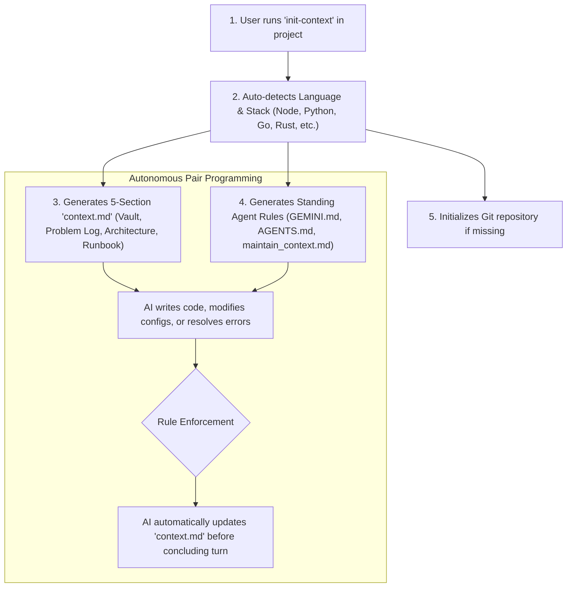

<div align="center">

# 🧠 Auto-Context

**Autonomous Context & Instruction Management Protocol for AI Coding Assistants**

[](https://pypi.org/project/auto-context-cli/)
[](https://pypi.org/project/auto-context-cli/)
[](https://github.com/Cyber-arghya/auto-context/releases/tag/v1.0.2)
[](https://opensource.org/licenses/MIT)
[](#-quick-one-line-install)
[](#-supported-ai-assistants)

*Never lose context, forgotten architecture decisions, or unlogged bug fixes again.*

[English](#-english-documentation) • [বাংলা নির্দেশিকা](#-বাংলা-নির্দেশিকা-bengali-guide) • [Installation](#-quick-one-line-install) • [CLI Usage](#-cli-usage)

</div>

---

## ⚡ Quick One-Line Install

No manual git clones or complex PATH configurations required. Install directly via PyPI or using our 1-click installer:

### 📦 Direct via PyPI (Universal - Windows, macOS, Linux, WSL2):
```bash
# Recommended via uv (fast & isolated):
uv tool install auto-context-cli

# Or via standard pip:
pip install auto-context-cli

# Or via pipx:
pipx install auto-context-cli
```

### 🪟 Windows (PowerShell / `pwsh` 1-Click Installer):
```powershell
irm https://raw.githubusercontent.com/Cyber-arghya/auto-context/main/install.ps1 | iex
```

### 🐧 Linux / WSL2 / macOS (Bash / Zsh 1-Click Installer):
```bash
curl -sSL https://raw.githubusercontent.com/Cyber-arghya/auto-context/main/install.sh | bash
```

> **Note:** The installer automatically configures `init-context` in your user `PATH`, registers shell functions, and provisions the global **Antigravity AI Agent Plugin**.

---

## 🚀 CLI Usage

Inside any existing or brand new project folder, simply run:

```bash
# Navigate to your project
cd /path/to/any-project

# Initialize autonomous context tracking
init-context
```

### Options & Flags:
```text
init-context [OPTIONS] [DIRECTORY]

OPTIONS (CONTEXT & RULES):
  -r, --new-rule <NAME>     Scaffold a new rule file (.agents/rules/<name>.md)
  -s, --new-skill <NAME>    Scaffold a new skill folder (.agents/skills/<name>/SKILL.md)
  -g, --global              Target global plugin scope (~/.gemini/config/plugins/auto-context/)
  -f, --force               Overwrite existing context.md and standing rule files
  -d, --dry-run             Preview generated structure without writing to disk
  -v, --version             Display current version
  -h, --help                Show help documentation

OPTIONS (CENTRAL MEMORY & GRANULAR SHARING):
  memory init [REPO]        Initialize private central memory repo (~/.auto-context/memory)
  memory push               Audit secrets & push memory brain to private GitHub repo
  memory pull [URL]         Pull & sync central memory brain from remote repo
  memory status             Show status of central memory brain
  share <NAME>              Audit & publish skill or rule to GitHub Gist
  import <URL>              Audit & import skill or rule from GitHub Gist or URL
  update                    Safely update CLI, global plugin & public rules (Non-breaking)
  update --check            Check for updates without modifying files
  update -w, --workspace    Update managed system rules in active workspace
  update -g, --global       Sync global plugin (~/.gemini/config/plugins/auto-context/)
  update -c, --cli          Upgrade auto-context-cli package via uv/pipx/pip
  --as <NAME>               Custom name when importing a skill or rule
  --public                  Publish shared Gist as public (default)
  --secret, --private       Publish shared Gist as unlisted/secret

OPTIONS (MCP TOOLING):
  --add-mcp <NAME>          Add or update an MCP server configuration
  --remove-mcp <NAME>       Remove an MCP server from configuration
  --list-mcp                List all active MCP server tools
  --preset <PRESET>         Preset template (sqlite, postgres, github, filesystem, brave, fetch)
  --command <CMD>           Executable command for stdio server (e.g. npx, uvx, python3)
  --args <ARGS>             Arguments to pass to command
  --url <URL>               Streamable HTTP endpoint URL for remote MCP server
  --env <KEY=VAL,...>       Environment variables (e.g. 'GITHUB_TOKEN=xyz')
```

---

## 🔄 Modular Upstream Sync & Non-Breaking Updates (আপডেট ও সিঙ্ক)

When new public rules, skills, or agent capabilities are added to the official [Cyber-arghya/auto-context](https://github.com/Cyber-arghya/auto-context) repository:

### 1️⃣ Automatic Background Notification
`auto-context` includes a lightweight, cached (24h TTL) update notifier. Whenever you or an AI agent runs `init-context`, it unobtrusively checks PyPI and GitHub. If new upstream rules or versions are available, a clean banner is displayed:
```text
╭─────────────────────────────────────────────────────────────────────────────╮
│ 🔔 Auto-Context Update Available: v1.0.1 → v1.0.2                           │
│    New public rules, skills, and upstream capabilities are ready.           │
│    Run 'init-context update' to sync modularly without breaking local context.│
╰─────────────────────────────────────────────────────────────────────────────╯
```

### 2️⃣ 1-Command Safe Modular Update
Run:
```bash
init-context update
```
- **Upgrades CLI Package:** Automatically updates `auto-context-cli` via `uv tool`, `pipx`, or `pip`.
- **Syncs Global Plugin:** Updates `~/.gemini/config/plugins/auto-context/` (`rules/AGENTS.md`, `skills/auto-context/SKILL.md`) with upstream instructions.
- **Syncs Workspace System Rules:** Updates system rules (`.agents/rules/maintain_context.md`, `AGENTS.md`, `GEMINI.md`).

> [!TIP]
> **Strict Non-Breaking Guarantees:**
> - **Zero Context Loss:** `context.md` is **NEVER** modified or overwritten. All project credentials, architecture diagrams, and problem history remain 100% intact.
> - **Secret Protection:** `context.local.md`, `.env`, and test logins are **NEVER** touched.
> - **Custom Rule Safety:** Your personal rules (e.g. `docker-multi-stage.md`, `my-style.md`) are **NEVER** overwritten or deleted.
> - **Automatic Backup:** If you customized `AGENTS.md`, the updater automatically creates an `AGENTS.md.bak` backup.

---

## 🔌 MCP (Model Context Protocol) Tooling Management (টুল ম্যানেজমেন্ট)

Auto-Context allows you and your AI agents to seamlessly install, update, list, and delete **MCP servers** with single commands:

### 1️⃣ Add Popular Pre-configured MCP Servers (Secure Secret Pattern)
Tokens and connection strings are **never stored as plaintext** in config files or committed to Git. Instead, they reference environment variables (`${VAR_NAME}`), automatically create safe placeholders in `.env.example`, and protect `.env` in `.gitignore`:

```bash
# Add SQLite database query tool (local file)
init-context --add-mcp sqlite --args "database.db"

# Add PostgreSQL tool (securely references ${DATABASE_URL} from .env)
init-context --add-mcp postgres

# Add GitHub API tool (securely references ${GITHUB_PERSONAL_ACCESS_TOKEN} from .env)
init-context --add-mcp github

# Add Brave Search tool (securely references ${BRAVE_API_KEY} from .env)
init-context --add-mcp brave

# Customize which environment variable holds the secret
init-context --add-mcp github --env-var MY_CUSTOM_GH_TOKEN
```

### 2️⃣ 🐍 Python vs. Node Runtimes: `uvx` vs. `npx`
Auto-Context automatically aligns stdio MCP tools with your project's ecosystem:
* **Auto-Detection:** If your workspace has a `pyproject.toml`, `requirements.txt`, or `Pipfile`, tools like `sqlite`, `git`, and `fetch` automatically use `uvx` (`mcp-server-*`). In Node.js / JavaScript projects, it defaults to `npx` (`@modelcontextprotocol/server-*`).
* **Explicit Runtime Flag (`--runtime` / `--runner`):** You can force your preferred runtime at any time:
  ```bash
  # Force Python uvx runner
  init-context --add-mcp sqlite --runtime uvx

  # Force Node.js npx runner
  init-context --add-mcp sqlite --runtime npx

  # Python-native tools (DuckDB, Time, Git)
  init-context --add-mcp duckdb
  init-context --add-mcp time
  init-context --add-mcp git --runtime uvx
  ```

### 3️⃣ Add Custom Stdio or Remote HTTP MCP Servers
```bash
# Add custom Python/Node MCP server
init-context --add-mcp my-tool --command "python3" --args "server.py"

# Add remote Streamable HTTP MCP server
init-context --add-mcp remote-api --url "https://mcp.mycompany.com/mcp"
```

### 4️⃣ List and Delete MCP Tools
```bash
# List all active project or global MCP tools
init-context --list-mcp
init-context --list-mcp -g

# Remove an MCP tool
init-context --remove-mcp sqlite
init-context --remove-mcp github -g
```

### 💡 Lifecycle Note: Mid-Flight Execution vs. Next-Session MCP (হাইব্রিড মডেল)
> **Host Client Reality:** Most MCP host environments (Antigravity IDE, Cursor, Claude Desktop) load MCP tools **only during session startup**. Modifying `mcp_config.json` mid-session configures the tool for future turns, but requires a session reload/restart before the LLM's active tool schema updates.
> 
> **Recommended Dual-Path Strategy:**
> 1. **Current Session (Immediate):** The AI uses CLI commands / scripts (`sqlite3`, `gh`, `curl`) to complete the task right now without interruption.
> 2. **Persistent Setup (Future Sessions):** `init-context --add-mcp <name>` configures the native MCP tool so it is permanently ready upon next session start or window reload.

---

## 🛠️ Adding Custom Skills & Rules (কাস্টম স্কিল ও রুল যুক্ত করার নিয়ম)

You can easily teach your AI assistants new abilities (**Skills**) or enforce custom guidelines (**Rules**), either for a **single project (Local)** or across your **entire computer (Global)**.

### 🧠 Skills vs. Rules: What is the Difference?

| Type | Purpose | When Active | Format / Location |
| :--- | :--- | :--- | :--- |
| **Rule** | Behavioral constraints, coding standards, security boundaries, or test requirements. | Always active (`trigger: always_on`) or context-triggered. | `.agents/rules/<name>.md` or `GEMINI.md` |
| **Skill** | Step-by-step procedures, deployment runbooks, debugging steps, or CLI tool guides. | Activated on-demand when relevant task is requested. | `.agents/skills/<name>/SKILL.md` |

> [!IMPORTANT]
> **Core Directives for AI Coding Agents:**
> - **Zero Token Waste:** DO NOT burn tokens manually searching directories or reading files to check for existing rules. Directly run `init-context -r <name> [-g]` — the CLI has instant built-in duplicate detection and collision guards.
> - **Mandatory Global Scope:** When the user mentions "for future", "always", or defines a reusable standard, **MANDATORY: Always pass `--global` (`-g`)** and immediately follow with `init-context memory push`.

---

### 1️⃣ How to Add a New Rule

#### Method A: Using 1-Command CLI (Recommended)
```bash
# In Bash / WSL2 / macOS:
init-context -r code-style              # Create local rule for active project
init-context -r security-policy --global # Create global rule for ALL projects

# In Windows PowerShell:
init-context -NewRule code-style
init-context -NewRule security-policy -Global
```

#### Method B: Manual File Creation
Create a file at `.agents/rules/my-rule.md`:
```markdown
---
name: my-rule
description: Enforce TypeScript strict null checks and ESLint formatting.
trigger: always_on
---

# Rule: TypeScript & Formatting Standards

## Guidelines
- Never use 'any' type in production code.
- Run 'npm run lint' before finalizing any changes.
```

---

### 2️⃣ How to Add a New Skill

#### Method A: Using 1-Command CLI (Recommended)
```bash
# In Bash / WSL2 / macOS:
init-context -s deploy-docker           # Create local skill for active project
init-context -s server-diagnostics -g   # Create global skill for ALL projects

# In Windows PowerShell:
init-context -NewSkill deploy-docker
init-context -NewSkill server-diagnostics -Global
```

#### Method B: Manual File Creation
Create a folder and file at `.agents/skills/deploy-docker/SKILL.md` with standard YAML frontmatter:
```markdown
---
name: deploy-docker
version: 1.0.0
description: Step-by-step procedure to build and deploy dockerized containers.
triggers: ["docker", "container", "compose", "dockerfile"]
---

# Skill: Docker Deployment Runbook

## When to Activate
- When the user asks to build, run, or deploy Docker containers.

## Step-by-Step Procedure
1. Build the production image:
   ```bash
   docker compose build --no-cache
   ```
2. Run health check on containers:
   ```bash
   docker compose ps
   ```
```

---

## ⚡ Two-Tier Progressive Disclosure (Token-Optimized Architecture)

To avoid context window bloat and burning 20k–30k tokens at session startup, Auto-Context enforces a **Two-Tier Progressive Disclosure Protocol**:

```
┌─────────────────────────────────────────────────────────────────────────────┐
│ Tier 1: Lightweight Index in context.md (~150 Tokens)                       │
│ - Lists: Skill Name, Version, One-line Description, Trigger Keywords       │
│ - Target Token Budget: < 800 tokens at boot                                 │
└──────────────────────────────────────┬──────────────────────────────────────┘
                                       │ When user prompt matches trigger
                                       ▼ (e.g. "build docker container")
┌─────────────────────────────────────────────────────────────────────────────┐
│ Tier 2: On-Demand Dynamic Loading (read_file)                               │
│ - Agent inspects .agents/skills/<skill-name>/SKILL.md                       │
│ - Executes the step-by-step procedure and concludes                         │
│ - Future chats remain clean and unbloated!                                  │
└─────────────────────────────────────────────────────────────────────────────┘
```

### 📦 Default Starter Pack (Built-in Rules & Skills)
Every initialized project automatically comes equipped with:
* **Default Rules:**
  1. `maintain_context.md`: Autonomous context sync, self-evolution, and progressive disclosure protocol.
  2. `security-boundaries.md`: Zero plaintext secrets in Git, strict `.env` isolation.
  3. `code-standards.md`: Clean code, DRY principles, early returns, and conventional commits.
* **Default Skills:**
  1. `docker-ops`: Multi-stage Dockerfiles, compose setups, container diagnostics, cleanup.
  2. `git-workflow`: Conventional commits, branch hygiene, safe rebasing, merge conflict resolution.
  3. `server-diagnostics`: RAM/swap health checks, CPU load, open sockets, disk utilization.
  4. `browser-testing`: UI and mock API automation using `context.local.md` without credential amnesia.

---

### 3️⃣ Local vs. Global Scopes

* **Local Scope (`.agents/`):**
  * Stored inside your project folder (`.agents/rules/` and `.agents/skills/`).
  * Can be committed to Git so teammates and CI/CD share the exact same rules.
* **Global Scope (`~/.gemini/config/plugins/auto-context/`):**
  * Stored machine-wide.
  * Every single project opened in Antigravity automatically inherits these skills and rules.

---

## 🧠 Central Memory Brain & Dotfiles Culture for AI Agents

Developers maintain `.dotfiles` on GitHub to configure any Linux/macOS machine in seconds. **Auto-Context** brings this exact dotfiles paradigm to **AI Coding Agents**:

```
┌─────────────────────────────────────────────────────────────────────────────┐
│                    Developer's Workstations & Cloud VMs                     │
│  [Ubuntu Server / WSL2]          [Windows Desktop]         [macOS Laptop]   │
│         │                               │                        │          │
│         ▼                               ▼                        ▼          │
│  ~/.auto-context/memory         ~/.auto-context/memory   ~/.auto-context... │
└──────────────────────────────────────┬──────────────────────────────────────┘
                                       │ 🔒 Pre-Push Zero-Bypass Secret Auditor
                                       ▼ (Rejects tokens, certs, .env)
┌─────────────────────────────────────────────────────────────────────────────┐
│               Private GitHub Repository: auto-context-memory                │
│ - profile.md: Developer communication style, language, & clean code rules   │
│ - rules/: Machine-wide coding guidelines synced across all projects          │
│ - skills/: Curated runbooks, workflows, and diagnostics                      │
│ - Zero Data Loss: Reinstall OS and run 'init-context memory pull' to restore!│
└─────────────────────────────────────────────────────────────────────────────┘
```

### 1️⃣ Initialize Your Private Brain (`memory init`)
Initializes local storage (`~/.auto-context/memory`), generates `profile.md`, hardens `.gitignore`, and automatically creates a **strictly Private** repository on GitHub:

```bash
# Initialize with default private repo name (auto-context-memory)
init-context memory init

# Or customize private repository name
init-context memory init my-agent-brain
```

> [!IMPORTANT]
> **Strictly Private Flag Enforcement:** `memory init` automatically injects the `--private` flag into `gh repo create` without bypass. Your developer habits and server notes will never be published publicly by mistake.

### 2️⃣ Pre-Push Secret Auditor with Zero-Bypass Hard-Block (`memory push`)
Before committing or pushing to your private memory repository, Auto-Context recursively audits every file:
* **Prohibited Files:** `.env`, `.env.*`, `id_rsa`, `id_ed25519`, `authorized_keys`, `known_hosts`
* **Prohibited Keys:** `*.pem`, `*.key`, `*.p12`, `*.pfx`, `*.kdbx`
* **Prohibited Tokens:** `ghp_`, `sk_live_`, `sk-ant-`, `AIza`, `AKIA`, `BEGIN PRIVATE KEY`, or hardcoded passwords.

If any secret is detected, the script **immediately terminates with Exit 1**, printing the exact file path, line number, pattern, and masked preview. Zero secrets reach remote storage!

```bash
init-context memory push
```

### 3️⃣ Granular Sharing via GitHub Gist (`share <name>`)
Share a single battle-tested skill or rule with the developer community without exposing your private memory brain:

```bash
# Share a skill as a public GitHub Gist
init-context share git-workflow

# Or share as an unlisted/secret Gist
init-context share docker-ops --secret
```

Outputs a direct shareable Gist link and the exact 1-liner for other developers to import it.

### 4️⃣ Gist Import with Collision Guard (`import <url>`)
Import any shared skill or rule directly into your local project or global brain:

```bash
# Import into local project (.agents/skills/<name>/SKILL.md)
init-context import https://gist.github.com/Cyber-arghya/4d9e7b415a772c91ba2066fa19b8df9c

# Import globally across all projects (~/.gemini/config/plugins/auto-context/skills/)
init-context import <gist-url> --global

# Import with a custom local name
init-context import <gist-url> --as custom-deploy-skill
```

> [!TIP]
> **Collision Guard (Overwrite Protection):** If an imported skill or rule already exists with the same name, Auto-Context will never silently overwrite it. In an interactive terminal, it prompts you: `[O]verwrite / [R]ename / [C]ancel`. In non-interactive CI/CD, it safely exits with `1` unless `--force` is explicitly provided.

---

## 💡 How It Works



Whenever an AI coding assistant operates in an `auto-context` repository:
1. **Zero-User-Prompting Mandate:** You never have to remind the AI to update notes.
2. **Problem & Incident Vault:** Every bug, connection timeout, DNS issue, or build error is logged alongside its root cause and exact terminal commands used to fix it.
3. **Master Configuration Vault:** IPs, ports, usernames, API tokens, and environment parameters stay synchronized.
4. **Reproducibility:** A developer or fresh OS can reconstruct the environment using the embedded runbook.

---

## 📁 Generated Files Overview

| File | Purpose | Security & Git Status |
| :--- | :--- | :--- |
| [`context.md`](./templates/context.template.md) | Single Source of Truth: Architecture, problem logs, and reproduction runbook. | Tracked in Git |
| [`context.local.md`](./templates/context.local.template.md) | 🔒 Local Sandbox & Dummy Vault: Mock test logins, seed users, local ports. | STRICTLY GIT-IGNORED (`chmod 600`) |
| [`GEMINI.md`](./templates/GEMINI.template.md) | Project-level standing rule enforcing continuous autonomous synchronization. | Tracked in Git |
| [`AGENTS.md`](./templates/AGENTS.template.md) | Universal agent instruction file for non-Antigravity environments. | Tracked in Git |
| [`.agents/rules/maintain_context.md`](./templates/maintain_context.template.md) | Native Antigravity progressive disclosure rule (`trigger: always_on`). | Tracked in Git |

---

## 🔒 Local Sandbox Vault (`context.local.md`) — Zero Prompt Injection & Leak Protection

When AI agents perform browser automation (Playwright/Puppeteer), API testing, or local dev integration, they need test credentials (e.g. `admin@test.local / pass123`).

To prevent **Prompt Injection Leaks** and keep production secrets safe:
1. **Mock Data Only:** `context.local.md` is strictly reserved for local mock/dummy data, seed accounts, and localhost ports.
2. **Zero Real Secrets:** Real production API keys, database passwords, or live payment tokens MUST NEVER be stored in `context.local.md` or `context.md`; they remain in `.env` or OS Keychain.
3. **Automated Git Isolation:** `init-context` automatically adds `context.local.md` and `*.local.md` to `.gitignore` and sets file permissions to `chmod 600`.
4. **No Chat Amnesia:** The AI assistant inspects `context.local.md` automatically, remembering how to log into your local app across new chat sessions without asking you every time.

---

## 🤖 Supported AI Assistants

* **Google Antigravity IDE & CLI (`agy`)** *(Native full plugin support)*
* **Cursor AI** *(Reads `AGENTS.md` and `context.md`)*
* **Claude Code / Anthropic Agent**
* **GitHub Copilot Chat & Workspace**
* **Windsurf IDE (Codeium)**
* **Cline / Roo Code**

---

## 🇧🇩 বাংলা নির্দেশিকা (Bengali Guide)

### এটি কী এবং কেন প্রয়োজন?
আমরা যখন এআই অ্যাসিস্ট্যান্ট (Antigravity, Cursor, Claude Code) দিয়ে কোডিং বা সার্ভার কনফিগার করি, তখন কিছুক্ষণ পর এআই আগের কনফিগারেশন, সার্ভার আইপি বা পুরোনো এরর ভুলে যায়। 

**Auto-Context** আপনার প্রজেক্টের রুটে একটি স্বয়ংক্রিয় `context.md` এবং কিছু শক্তিশালী নিয়ম (Rules) সেট করে দেয়। ফলে:
1. **আপনাকে আর মনে করিয়ে দিতে হবে না:** এআই নিজে থেকেই প্রতি কাজের শেষে `context.md` ফাইল আপডেট করে দেবে।
2. **সমস্যার নিখুঁত সমাধান রেকর্ড থাকে:** টার্মিনালে কোনো এরর সমাধান করলে সেই এররটি কেন হয়েছিল এবং কী কমান্ড দিয়ে ঠিক করা হয়েছে তা চার্ট আকারে সেভ থাকবে।
3. **পাসওয়ার্ড ও পোর্ট ভল্ট:** সার্ভারের স্ট্যাটিক আইপি, ক্লাউডফ্লেয়ার টানেল আইডি বা ডাটাবেজ পোর্ট সবসময় এক ফাইলে নিখুঁতভাবে থাকবে।

### ইনস্টলেশন ও ব্যবহার:
* **PyPI থেকে সরাসরি ইনস্টল করতে (সবার জন্য সহজ):**
  ```bash
  pip install auto-context-cli
  # অথবা uv দিয়ে:
  uv tool install auto-context-cli
  ```
* **উইন্ডোজ পাওয়ারশেল (1-Click Installer):**
  ```powershell
  irm https://raw.githubusercontent.com/Cyber-arghya/auto-context/main/install.ps1 | iex
  ```
* **লিনাক্স / WSL2 / macOS (1-Click Installer):**
  ```bash
  curl -sSL https://raw.githubusercontent.com/Cyber-arghya/auto-context/main/install.sh | bash
  ```
* **নতুন প্রজেক্টে ব্যবহার:**
  যেকোনো প্রজেক্ট ফোল্ডারে ঢুকে টার্মিনালে শুধু লিখুন:
  ```bash
  init-context
  ```
  ব্যস! আপনার প্রজেক্টে স্বয়ংক্রিয় কনটেক্সট ট্র্যাকিং চালু হয়ে যাবে।

### নতুন স্কিল বা রুল তৈরি করার নিয়ম:
> [!IMPORTANT]
> **এআই কোডিং এজেন্টের জন্য বাধ্যতামূলক নির্দেশিকা:**
> - **জিরো টোকেন অপচয় (Zero Token Waste):** কোনো রুল বা স্কিল আগে থেকে আছে কিনা তা চেক করতে ম্যানুয়ালি ফাইল খোঁজা বা পড়ার কোনো প্রয়োজন নেই। সরাসরি `init-context -r <name> [-g]` রান করুন — সিএলআই স্বয়ংক্রিয়ভাবে ডুপ্লিকেট শনাক্ত ও কলিশন গার্ড দিয়ে প্রোটেক্ট করে।
> - **বাধ্যতামূলক গ্লোবাল স্কোপ (Mandatory Global Scope):** ইউজার যখন "for future", "always" বা ভবিষ্যতের জন্য কোনো সাধারণ নিয়ম সেভ করতে বলবে, তখন অবশ্যই `--global` (`-g`) ব্যবহার করতে হবে এবং সাথে সাথে `init-context memory push` রান করে সেন্ট্রাল মেমরিতে সিঙ্ক করতে হবে।
* **নতুন রুল (Rule) তৈরি করতে:**
  ```bash
  init-context -r my-rule-name       # বর্তমান প্রজেক্টের জন্য
  init-context -r my-rule-name -g    # সকল প্রজেক্টের জন্য গ্লোবালি
  ```
* **নতুন স্কিল (Skill) তৈরি করতে:**
  ```bash
  init-context -s my-skill-name      # বর্তমান প্রজেক্টের জন্য
  init-context -s my-skill-name -g   # সকল প্রজেক্টের জন্য গ্লোবালি
  ```

### ⚡ টু-টায়ার প্রোগ্রেসিভ ডিসক্লোজার (টোকেন সাশ্রয়ী আর্কিটেকচার):
শুরুতেই সব স্কিলের বড় ফাইল লোড করে চ্যাট ভারী করা হয় না। এআই শুরুতে মাত্র ১৫০–২০০ টোকেনের একটি ইনডেক্স (`context.md` Section 5) পড়ে। যখন নির্দিষ্ট টাস্কের কিওয়ার্ড মিলবে (যেমন: "docker", "rebase", "diagnostics", "ui test"), কেবল তখনই সংশ্লিষ্ট পূর্ণাঙ্গ স্কিলটি অন-ডিমান্ড মেমরিতে লোড হয়। ফলে টোকেন খরচ প্রায় ৮০% হ্রাস পায়!

### 🧠 সেন্ট্রাল মেমরি ব্রেইন ও ডটফাইলস (Disaster Recovery & Dotfiles):
যেমনভাবে লিনাক্সে `.dotfiles` দিয়ে চোখের পলকে সব কনফিগারেশন সেটআপ করা যায়, তেমনি Auto-Context দিয়ে আপনার এআই এজেন্টের মেমরি ও স্কিল ক্লাউডে নিরাপদে সেভ থাকে:
1. **প্রাইভেট মেমরি তৈরি (`memory init`):**
   ```bash
   init-context memory init          # স্বয়ংক্রিয়ভাবে গিটহাবে Private রিপোজিটরি তৈরি করবে
   ```
2. **জিরো-বাইপাস সিক্রেট অডিটর ও পুশ (`memory push`):**
   মেমরি পুশ করার আগে স্ক্রিপ্টটি প্রতিটি ফাইল স্ক্যান করে। কোনো ফাইলে ভুলবশত টোকেন (`ghp_`, `sk_live_`, `AIza`, ইত্যাদি) বা `.env` ফাইল থাকলে স্ক্রিপ্ট তৎক্ষণাৎ Exit 1 দিয়ে আটকে দেয় এবং ফাইলের নাম ও লাইন নাম্বার দেখিয়ে দেয়:
   ```bash
   init-context memory push          # সিক্রেট অডিট পাস করলে তবেই পুশ হবে
   ```
3. **অন্যান্য পিসি বা ওএস-এ মেমরি রিকভারি (`memory pull`):**
   ```bash
   init-context memory pull <repo-url> # সম্পূর্ণ মেমরি ও স্কিল নতুন মেশিনে নিমেষেই সচল
   ```

### 🤝 গ্র্যানুলার শেয়ারিং ও কলিশন গার্ড (Share & Import):
পুরো প্রাইভেট রিপো না পাঠিয়ে শুধুমাত্র একটি নির্দিষ্ট স্কিল বা রুল বন্ধুদের সাথে গিস্টের মাধ্যমে শেয়ার করতে পারবেন:
* **স্কিল শেয়ার করতে:**
  ```bash
  init-context share git-workflow   # GitHub Gist লিংক তৈরি করে দেবে
  ```
* **শেয়ারকৃত স্কিল ইমপোর্ট করতে (ওভাররাইট সুরক্ষা):**
  ```bash
  init-context import <gist-url>    # লোকাল প্রজেক্টে যুক্ত করবে
  init-context import <gist-url> -g # গ্লোবাল এআই প্লাগইনে যুক্ত করবে
  ```
  > **কলিশন গার্ড:** যদি একই নামের কোনো স্কিল আগে থেকেই থেকে থাকে, তবে এটি না জানিয়ে কখনো ওভাররাইট করবে না। টার্মিনালে আপনাকে ৩টি অপশন দেবে: `[O]verwrite / [R]ename / [C]ancel`।

### 🔄 মডুলার আপস্ট্রিম আপডেট ও স্বয়ংক্রিয় নোটিফিকেশন (Update & Sync):
অফিশিয়াল গিটহাব রিপোজিটরিতে নতুন কোনো রুলবুক, স্কিল বা এআই এজেন্ট টুল যুক্ত হলে ব্যবহারকারীরা খুব সহজে আপডেট পেতে পারেন:
1. **স্বয়ংক্রিয় নোটিফিকেশন ব্যানার:** চব্বিশ ঘণ্টায় একবার ব্যাকগ্রাউন্ডে চেক করে নতুন রুল আসলে টার্মিনালে সুন্দর নোটিফিকেশন দেখাবে।
2. **এক কমান্ডে নিরাপদ আপডেট (`init-context update`):**
   ```bash
   init-context update           # ফুল মডুলার আপডেট (CLI + গ্লোবাল প্লাগইন + সিস্টেম রুলস)
   init-context update --check   # কোনো আপডেট আছে কিনা শুধু চেক করতে
   init-context update -w        # শুধুমাত্র বর্তমান প্রজেক্টের সিস্টেম রুলস আপডেট করতে
   ```
> **ব্রেকিং-চেঞ্জ মুক্ত সুরক্ষা (Zero Breaking Guarantee):**
> * আপনার প্রজেক্টের `context.md`, `context.local.md` বা `.env` ফাইলে **কখনোই হাত দেওয়া হবে না**।
> * আপনার তৈরিকৃত কোনো কাস্টম রুল মুছে যাবে না।
> * কোনো ফাইলে কাস্টম পরিবর্তন থাকলে স্বয়ংক্রিয়ভাবে `.bak` ব্যাকআপ তৈরি হবে।

### নিরাপদ MCP টুল ম্যানেজমেন্ট (Secure Secrets via .env):
টোকেন বা পাসওয়ার্ড কখনোই কনফিগ ফাইলে ওপেন টেক্সটে সেভ হয় না, বরং `.env` এবং `.gitignore`-এর মাধ্যমে নিরাপদ থাকে:
* **টুল যুক্ত করতে (Node `npx` বা Python `uvx` সাপোর্ট):**
  ```bash
  init-context --add-mcp sqlite             # অটো ডিটেকশন (Node হলে npx, Python হলে uvx)
  init-context --add-mcp sqlite --runtime uvx # পাইথন uvx প্যাকেজ রানার নিশ্চিত করতে
  init-context --add-mcp duckdb             # পাইথন-বেসড DuckDB MCP সার্ভার
  init-context --add-mcp github             # GitHub API (.env থেকে টোকেন পড়বে)
  init-context --add-mcp postgres           # PostgreSQL (.env থেকে DATABASE_URL পড়বে)
  ```
* **টুল তালিকা দেখতে ও মুছতে:**
  ```bash
  init-context --list-mcp                   # সক্রিয় টুল দেখতে
  init-context --remove-mcp github          # টুল মুছে ফেলতে
  ```

---

## 📦 Repository Structure

```text
auto-context/
├── pyproject.toml                   # Modern PEP 517/621 package & CLI configuration
├── src/
│   └── auto_context/
│       ├── __init__.py
│       ├── main.py                  # Root Typer CLI & backwards-compatible flag router
│       ├── config.py                # Centralized paths (~/.auto-context, ~/.gemini, etc.)
│       ├── security.py              # Zero-Bypass secret scanner & credential auditor
│       ├── commands/
│       │   ├── init_cmd.py          # Workspace scaffolding & stack detection
│       │   ├── memory.py            # Central private git repo brain management
│       │   ├── mcp.py               # Native JSON MCP registry & runtime selector
│       │   ├── share.py             # Granular Gist publishing via gh / httpx
│       │   └── import_cmd.py        # Remote URL / Gist import & collision guard
│       └── templates/               # Package-bundled Markdown & JSON templates
├── plugin/                          # Antigravity Global Plugin bundle
│   ├── plugin.json                  # Manifest
│   ├── rules/AGENTS.md              # Global standing rule
│   └── skills/auto-context/SKILL.md # Progressive disclosure skill
├── install.sh                       # 1-Click universal installer (Linux / WSL2 / macOS)
├── install.ps1                      # 1-Click universal installer (Windows PowerShell)
├── setup.bat                        # Double-clickable Windows setup
├── uninstall.sh                     # Clean uninstaller for POSIX
├── uninstall.ps1                    # Clean uninstaller for Windows
├── LICENSE                          # MIT License
└── README.md                        # Documentation
```

---

## 👤 Author

* **GitHub:** [@Cyber-arghya](https://github.com/Cyber-arghya)
* **Email:** [work.arghya01@gmail.com](mailto:work.arghya01@gmail.com)

---

## 📄 License

This project is open-source and licensed under the [MIT License](./LICENSE). Contributions and pull requests are warmly welcomed!

