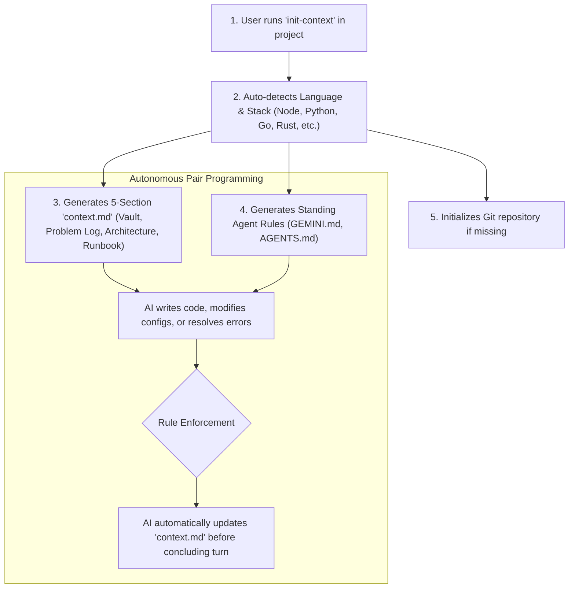

<div align="center">

# 🧠 Auto-Context

**Autonomous Context & Instruction Management Protocol for AI Coding Assistants**

[](https://pypi.org/project/auto-context-cli/)
[](https://pypi.org/project/auto-context-cli/)
[](https://github.com/Cyber-arghya/auto-context/releases/tag/v1.4.0)
[](https://opensource.org/licenses/MIT)
[](#-quick-one-line-install)
[](#-supported-ai-assistants)

*Never lose context, forgotten architecture decisions, or unlogged bug fixes again.*

[Installation](#-quick-one-line-install) • [CLI Usage](#-cli-usage) • [How It Works](#-how-it-works) • [Architecture](#-hub--satellite-modular-architecture)

</div>

---

## ⚡ Quick One-Line Install

No manual git clones or complex PATH configurations required. Install directly via PyPI or using our 1-click installer:

### 📦 Direct via PyPI (Universal - Windows, macOS, Linux, WSL2):
```bash
# Recommended via uv (fast & isolated):
uv tool install auto-context-cli

# Or via standard pip:
pip install auto-context-cli

# Or via pipx:
pipx install auto-context-cli
```

### 🪟 Windows (PowerShell / `pwsh` 1-Click Installer):
```powershell
irm https://raw.githubusercontent.com/Cyber-arghya/auto-context/main/install.ps1 | iex
```

### 🐧 Linux / WSL2 / macOS (Bash / Zsh 1-Click Installer):
```bash
curl -sSL https://raw.githubusercontent.com/Cyber-arghya/auto-context/main/install.sh | bash
```

> **Note:** The installer automatically configures `init-context` in your user `PATH`, registers shell functions, and provisions the global **Antigravity AI Agent Plugin**.

---

## 🚀 CLI Usage

Inside any existing or brand new project folder, simply run:

```bash
# Navigate to your project
cd /path/to/any-project

# Initialize autonomous context tracking
init-context
```

### Command Reference & Syntax:

Auto-Context supports both modern subcommands (`init-context <command>`) and standard legacy flags:

| Command | Shorthand / Flag | Description |
| :--- | :--- | :--- |
| `init-context init [DIR]` | `init-context [DIR]` | Scaffolds 5-tier context in active or specified directory. |
| `init-context rule <name>` | `init-context -r <name> [-a]` | Scaffolds a rule or appends to a domain with `registry.json` duplicate protection. |
| `init-context skill <name>` | `init-context -s <name>` | Scaffolds a new agent skill directory with triggers & runbook. |
| `init-context promote <name>` | — | Promotes local workspace rule/skill to Global Plugin & Central Memory. |
| `init-context update` | — | Modular, non-breaking update for CLI, global plugin & system rules. |
| `init-context share <name>` | — | Audits secrets and shares a rule or skill via GitHub Gist. |
| `init-context import <url>` | — | Imports a rule or skill with 3-way Collision Guard protection. |
| `init-context memory init` | — | Initializes private GitHub brain repository (`~/.auto-context/memory`). |
| `init-context memory push` | — | Auto-harvests workspace rules, audits secrets & pushes to private GitHub. |
| `init-context memory pull` | — | Pulls and restores central brain on a new machine. |
| `init-context memory status` | — | Displays central brain location, remote URL, and rules/skills count. |
| `init-context memory remote [name]` | — | View, switch, or interactively create private remote GitHub repository. |
| `init-context memory reset` | — | Resets and re-initializes local memory cache with optional auto-harvest. |
| `init-context mcp add <name>`| `init-context --add-mcp` | Adds or updates an MCP tool (Node `npx` or Python `uvx`). |
| `init-context mcp list` | `init-context --list-mcp` | Lists all active MCP server configurations. |
| `init-context mcp remove <name>`| `init-context --remove-mcp` | Safely removes an MCP server configuration. |

### Global Flags:
* `-g, --global`: Targets machine-wide scope (`~/.gemini/config/plugins/auto-context/` & `~/.auto-context/memory/`).
* `-f, --force`: Overwrites existing files (bypasses collision guards with confirmation).
* `-d, --dry-run`: Previews actions without writing files or modifying directories.
* `-v, --version`: Displays installed package version.

---

## 🛡️ Zero Git Footprint Guarantee

`auto-context` is engineered strictly as a **local development helper tool**. It never pollutes your project's Git commit history:
- **Global & Project Protection:** Automatically registers all AI assistant artifacts (`.agents/`, `.gemini/`, `context.md`, `context.local.md`, `AGENTS.md`, `GEMINI.md`, `*.bak`, `.auto-context/`, `auto-context/`) in your global Git excludesfile (`~/.gitignore_global`) and project `.gitignore`.
- **Clean Commits:** When committing or pushing your project repository, only your actual application source code is tracked.
- **Background Synchronization:** Your personal rules and skills remain safely backed up to your private Central Memory (`init-context memory push`), leaving zero unwanted files in client or personal project repositories.

---

## 🔄 Modular Upstream Sync & Non-Breaking Updates

When new public rules, skills, or agent capabilities are added to the official [Cyber-arghya/auto-context](https://github.com/Cyber-arghya/auto-context) repository:

### 1️⃣ Automatic Background Notification
`auto-context` includes a lightweight, cached (24h TTL) update notifier. Whenever you or an AI agent runs `init-context`, it unobtrusively checks PyPI and GitHub. If new upstream rules or versions are available, a clean banner is displayed:
```text
╭─────────────────────────────────────────────────────────────────────────────╮
│ 🔔 Auto-Context Update Available: v1.0.1 → v1.0.2                           │
│    New public rules, skills, and upstream capabilities are ready.           │
│    Run 'init-context update' to sync modularly without breaking local context.│
╰─────────────────────────────────────────────────────────────────────────────╯
```

### 2️⃣ 1-Command Safe Modular Update
Run:
```bash
init-context update
```
- **Upgrades CLI Package:** Automatically updates `auto-context-cli` via `uv tool`, `pipx`, or `pip`.
- **Syncs Global Plugin:** Updates `~/.gemini/config/plugins/auto-context/` (`rules/AGENTS.md`, `skills/auto-context/SKILL.md`) with upstream instructions.
- **Syncs Workspace System Rules:** Updates standing rules (`AGENTS.md`, `GEMINI.md`).

> [!TIP]
> **Strict Non-Breaking Guarantees:**
> - **Zero Context Loss:** `context.md` is **NEVER** modified or overwritten. All project credentials, architecture diagrams, and problem history remain 100% intact.
> - **Secret Protection:** `context.local.md`, `.env`, and test logins are **NEVER** touched.
> - **Custom Rule Safety:** Your personal rules (e.g. `docker-multi-stage.md`, `my-style.md`) are **NEVER** overwritten or deleted.
> - **Automatic Backup:** If you customized `AGENTS.md`, the updater automatically creates an `AGENTS.md.bak` backup.

---

## 🔌 MCP (Model Context Protocol) Tooling Management

Auto-Context allows you and your AI agents to seamlessly install, update, list, and delete **MCP servers** with single commands:

### 1️⃣ Add Popular Pre-configured MCP Servers (Secure Secret Pattern)
Tokens and connection strings are **never stored as plaintext** in config files or committed to Git. Instead, they reference environment variables (`${VAR_NAME}`), automatically create safe placeholders in `.env.example`, and protect `.env` in `.gitignore`:

```bash
# Add SQLite database query tool (local file)
init-context --add-mcp sqlite --args "database.db"

# Add PostgreSQL tool (securely references ${DATABASE_URL} from .env)
init-context --add-mcp postgres

# Add GitHub API tool (securely references ${GITHUB_PERSONAL_ACCESS_TOKEN} from .env)
init-context --add-mcp github

# Add Brave Search tool (securely references ${BRAVE_API_KEY} from .env)
init-context --add-mcp brave

# Customize which environment variable holds the secret
init-context --add-mcp github --env-var MY_CUSTOM_GH_TOKEN
```

### 2️⃣ 🐍 Python vs. Node Runtimes: `uvx` vs. `npx`
Auto-Context automatically aligns stdio MCP tools with your project's ecosystem:
* **Auto-Detection:** If your workspace has a `pyproject.toml`, `requirements.txt`, or `Pipfile`, tools like `sqlite`, `git`, and `fetch` automatically use `uvx` (`mcp-server-*`). In Node.js / JavaScript projects, it defaults to `npx` (`@modelcontextprotocol/server-*`).
* **Explicit Runtime Flag (`--runtime` / `--runner`):** You can force your preferred runtime at any time:
  ```bash
  # Force Python uvx runner
  init-context --add-mcp sqlite --runtime uvx

  # Force Node.js npx runner
  init-context --add-mcp sqlite --runtime npx

  # Python-native tools (DuckDB, Time, Git)
  init-context --add-mcp duckdb
  init-context --add-mcp time
  init-context --add-mcp git --runtime uvx
  ```

### 3️⃣ Add Custom Stdio or Remote HTTP MCP Servers
```bash
# Add custom Python/Node MCP server
init-context --add-mcp my-tool --command "python3" --args "server.py"

# Add remote Streamable HTTP MCP server
init-context --add-mcp remote-api --url "https://mcp.mycompany.com/mcp"
```

### 4️⃣ List and Delete MCP Tools
```bash
# List all active project or global MCP tools
init-context --list-mcp
init-context --list-mcp -g

# Remove an MCP tool
init-context --remove-mcp sqlite
init-context --remove-mcp github -g
```

### 💡 Lifecycle Note: Mid-Flight Execution vs. Next-Session MCP
> **Host Client Reality:** Most MCP host environments (Antigravity IDE, Cursor, Claude Desktop) load MCP tools **only during session startup**. Modifying `mcp_config.json` mid-session configures the tool for future turns, but requires a session reload/restart before the LLM's active tool schema updates.
> 
> **Recommended Dual-Path Strategy:**
> 1. **Current Session (Immediate):** The AI uses CLI commands / scripts (`sqlite3`, `gh`, `curl`) to complete the task right now without interruption.
> 2. **Persistent Setup (Future Sessions):** `init-context --add-mcp <name>` configures the native MCP tool so it is permanently ready upon next session start or window reload.

---

## 🛠️ Adding Custom Skills & Rules

You can easily teach your AI assistants new abilities (**Skills**) or enforce custom guidelines (**Rules**), either for a **single project (Local)** or across your **entire computer (Global)**.

### 🧠 Skills vs. Rules: What is the Difference?

| Type | Purpose | When Active | Format / Location |
| :--- | :--- | :--- | :--- |
| **Rule** | Behavioral constraints, coding standards, security boundaries, or test requirements. | Always active (`trigger: always_on`) or context-triggered. | `.agents/rules/<name>.md` or `GEMINI.md` |
| **Skill** | Step-by-step procedures, deployment runbooks, debugging steps, or CLI tool guides. | Activated on-demand when relevant task is requested. | `.agents/skills/<name>/SKILL.md` |

> [!IMPORTANT]
> **Core Directives for AI Coding Agents:**
> - **Zero Token Waste:** DO NOT burn tokens manually searching directories or reading files to check for existing rules. Directly run `init-context -r <name> [-g]` — the CLI has instant built-in duplicate detection and collision guards.
> - **Mandatory Global Scope:** When the user mentions "for future", "always", or defines a reusable standard, **MANDATORY: Always pass `--global` (`-g`)** and immediately follow with `init-context memory push`.

---

### 1️⃣ How to Add a New Rule

#### Method A: Using 1-Command CLI (Recommended)
```bash
# In Bash / WSL2 / macOS:
init-context -r code-style              # Create local rule for active project
init-context -r security-policy --global # Create global rule for ALL projects

# In Windows PowerShell:
init-context -NewRule code-style
init-context -NewRule security-policy -Global
```

#### Method B: Manual File Creation
Create a file at `.agents/rules/my-rule.md`:
```markdown
---
name: my-rule
description: Enforce TypeScript strict null checks and ESLint formatting.
trigger: always_on
---

# Rule: TypeScript & Formatting Standards

## Guidelines
- Never use 'any' type in production code.
- Run 'npm run lint' before finalizing any changes.
```

---

### 2️⃣ How to Add a New Skill

#### Method A: Using 1-Command CLI (Recommended)
```bash
# In Bash / WSL2 / macOS:
init-context -s deploy-docker           # Create local skill for active project
init-context -s server-diagnostics -g   # Create global skill for ALL projects

# In Windows PowerShell:
init-context -NewSkill deploy-docker
init-context -NewSkill server-diagnostics -Global
```

#### Method B: Manual File Creation
Create a folder and file at `.agents/skills/deploy-docker/SKILL.md` with standard YAML frontmatter:
```markdown
---
name: deploy-docker
version: 1.0.0
description: Step-by-step procedure to build and deploy dockerized containers.
triggers: ["docker", "container", "compose", "dockerfile"]
---

# Skill: Docker Deployment Runbook

## When to Activate
- When the user asks to build, run, or deploy Docker containers.

## Step-by-Step Procedure
1. Build the production image:
   ```bash
   docker compose build --no-cache
   ```
2. Run health check on containers:
   ```bash
   docker compose ps
   ```
```

---

## 🚀 Rule Promotion & Auto-Harvesting (`init-context promote`)

Sometimes a rule or workflow starts as a quick experiment in one project, but proves so valuable that you want every project across your machine and team to inherit it.

### 1️⃣ 1-Command Rule Promotion
```bash
init-context promote docker-multi-stage
```
* **Elevates Local to Global:** Copies `.agents/rules/docker-multi-stage.md` directly into `~/.gemini/config/plugins/auto-context/rules/` and `~/.auto-context/memory/rules/`.
* **Zero Rewriting:** Preserves all existing YAML frontmatter, guidelines, and constraints.
* **Instant Sync:** Immediately run `init-context memory push` to backup the newly promoted rule to your private Git brain.

### 2️⃣ Auto-Harvesting in Central Memory
When you run:
```bash
init-context memory push
```
The CLI automatically:
1. **Discovers Local Knowledge:** Scans the active workspace's `.agents/rules/` and `.agents/skills/`.
2. **Harvests to Central Memory:** Copies any new rules and skills into `~/.auto-context/memory/` without overwriting existing files.
3. **Audits Secrets:** Runs the Zero-Bypass security audit.
4. **Pushes to Private Remote:** Backs up everything to your private GitHub repo.
Even if an agent originally codified a rule locally, running `memory push` guarantees zero knowledge loss!

#### 🛡️ Resilient Remote Recovery & Local Reset:
- **Auto-Recreate on Remote 404:** If your remote repository is deleted or missing on GitHub, `init-context memory push` detects the 404 and automatically re-creates a new private repository via GitHub CLI (`gh`), reconnecting and pushing seamlessly.
- **Local Brain Reset (`init-context memory reset`):** Reset and re-scaffold local central memory cache while safely preserving your remote URL and re-harvesting active workspace rules.

---

## 🛰️ Hub & Satellite Modular Architecture

Dumping routes, models, problem logs, credentials, and runbooks into a single monolithic `context.md` causes context file bloat (1,000–5,000 lines). Every turn burns thousands of unnecessary tokens simply reading the context file!

Auto-Context solves this with the **Hub & Satellite Architecture**:

```
project-root/
├── context.md                    <─── The Executive Hub (Executive routing hub)
└── .agents/
    └── context/                  <─── Stack-Adaptive Satellites (Loaded on-demand)
        ├── routes.md             (API Endpoints & UI Page Map — loaded only for route tasks)
        ├── schema.md             (Database Schemas & ORM Models — loaded only for DB tasks)
        └── gotchas.md            (Critical Architecture Traps & Invariants)
```

### 2️⃣ The Brutal Truth Filter & `gotchas.md`
- **Zero Dead Logs:** A chronological diary of 50 minor solved bug typos is a waste of disk and token budget. Git already tracks commit history!
- **Gotchas Over History:** Auto-Context replaces useless bug logs with **`gotchas.md`**: non-obvious architecture traps, port collisions, and invariants that cannot be guessed from reading code.

---

## ⚡ Two-Tier Progressive Disclosure (Token-Optimized Architecture)

To avoid context window bloat and burning 20k–30k tokens at session startup, Auto-Context enforces a **Two-Tier Progressive Disclosure Protocol**:

```
┌─────────────────────────────────────────────────────────────────────────────┐
│ Tier 1: Lightweight Index in context.md (~150 Tokens)                       │
│ - Lists: Skill Name, Version, One-line Description, Trigger Keywords       │
│ - Target Token Budget: < 800 tokens at boot                                 │
└──────────────────────────────────────┬──────────────────────────────────────┘
                                       │ When user prompt matches trigger
                                       ▼ (e.g. "build docker container")
┌─────────────────────────────────────────────────────────────────────────────┐
│ Tier 2: On-Demand Dynamic Loading (read_file)                               │
│ - Agent inspects .agents/skills/<skill-name>/SKILL.md                       │
│ - Executes the step-by-step procedure and concludes                         │
│ - Future chats remain clean and unbloated!                                  │
└─────────────────────────────────────────────────────────────────────────────┘
```

### 📦 Default Starter Pack (Built-in Rules & Skills)
Every initialized project automatically comes equipped with:
* **Default Rules:**
  1. `code-standards.md`: Clean code, defensive coding, DRY principles, early returns, conventional commits.
  2. `security-boundaries.md`: Zero plaintext secrets in Git, strict `.env` isolation, boundary checks.
  3. `readme-docs-sync.md`: Mandatory README synchronization, executable verification, and automated tagging.
* **Default Skills:**
  1. `docker-ops`: Multi-stage Dockerfiles, compose setups, container diagnostics, cleanup.
  2. `git-workflow`: Conventional commits, branch hygiene, safe rebasing, merge conflict resolution.
  3. `server-diagnostics`: RAM/swap health checks, CPU load, open sockets, disk utilization.
  4. `browser-testing`: UI and mock API automation using `context.local.md` without credential amnesia.

---

### 3️⃣ Local vs. Global Scopes

* **Local Scope (`.agents/`):**
  * Stored inside your project folder (`.agents/rules/` and `.agents/skills/`).
  * Can be committed to Git so teammates and CI/CD share the exact same rules.
* **Global Scope (`~/.gemini/config/plugins/auto-context/`):**
  * Stored machine-wide.
  * Every single project opened in Antigravity automatically inherits these skills and rules.

---

## 🧠 Central Memory Brain & Dotfiles Culture for AI Agents

Developers maintain `.dotfiles` on GitHub to configure any Linux/macOS machine in seconds. **Auto-Context** brings this exact dotfiles paradigm to **AI Coding Agents**:

```
┌─────────────────────────────────────────────────────────────────────────────┐
│                    Developer's Workstations & Cloud VMs                     │
│  [Ubuntu Server / WSL2]          [Windows Desktop]         [macOS Laptop]   │
│         │                               │                        │          │
│         ▼                               ▼                        ▼          │
│  ~/.auto-context/memory         ~/.auto-context/memory   ~/.auto-context... │
└──────────────────────────────────────┬──────────────────────────────────────┘
                                       │ 🔒 Pre-Push Zero-Bypass Secret Auditor
                                       ▼ (Rejects tokens, certs, .env)
┌─────────────────────────────────────────────────────────────────────────────┐
│               Private GitHub Repository: auto-context-memory                │
│ - profile.md: Developer communication style, language, & clean code rules   │
│ - rules/: Machine-wide coding guidelines synced across all projects          │
│ - skills/: Curated runbooks, workflows, and diagnostics                      │
│ - Zero Data Loss: Reinstall OS and run 'init-context memory pull' to restore!│
└─────────────────────────────────────────────────────────────────────────────┘
```

### 1️⃣ Initialize Your Private Brain (`memory init`)
Initializes local storage (`~/.auto-context/memory`), generates `profile.md`, hardens `.gitignore`, and automatically creates a **strictly Private** repository on GitHub:

```bash
# Initialize with default private repo name (auto-context-memory)
init-context memory init

# Or customize private repository name
init-context memory init my-agent-brain
```

> [!IMPORTANT]
> **Strictly Private Flag Enforcement:** `memory init` automatically injects the `--private` flag into `gh repo create` without bypass. Your developer habits and server notes will never be published publicly by mistake.

### 2️⃣ Pre-Push Secret Auditor with Zero-Bypass Hard-Block (`memory push`)
Before committing or pushing to your private memory repository, Auto-Context recursively audits every file:
* **Prohibited Files:** `.env`, `.env.*`, `id_rsa`, `id_ed25519`, `authorized_keys`, `known_hosts`
* **Prohibited Keys:** `*.pem`, `*.key`, `*.p12`, `*.pfx`, `*.kdbx`
* **Prohibited Tokens:** `ghp_`, `sk_live_`, `sk-ant-`, `AIza`, `AKIA`, `BEGIN PRIVATE KEY`, or hardcoded passwords.

If any secret is detected, the script **immediately terminates with Exit 1**, printing the exact file path, line number, pattern, and masked preview. Zero secrets reach remote storage!

```bash
init-context memory push
```

### 3️⃣ Granular Sharing via GitHub Gist (`share <name>`)
Share a single battle-tested skill or rule with the developer community without exposing your private memory brain:

```bash
# Share a skill as a public GitHub Gist
init-context share git-workflow

# Or share as an unlisted/secret Gist
init-context share docker-ops --secret
```

Outputs a direct shareable Gist link and the exact 1-liner for other developers to import it.

### 4️⃣ Gist Import with Collision Guard (`import <url>`)
Import any shared skill or rule directly into your local project or global brain:

```bash
# Import into local project (.agents/skills/<name>/SKILL.md)
init-context import https://gist.github.com/Cyber-arghya/4d9e7b415a772c91ba2066fa19b8df9c

# Import globally across all projects (~/.gemini/config/plugins/auto-context/skills/)
init-context import <gist-url> --global

# Import with a custom local name
init-context import <gist-url> --as custom-deploy-skill
```

> [!TIP]
> **Collision Guard (Overwrite Protection):** If an imported skill or rule already exists with the same name, Auto-Context will never silently overwrite it. In an interactive terminal, it prompts you: `[O]verwrite / [R]ename / [C]ancel`. In non-interactive CI/CD, it safely exits with `1` unless `--force` is explicitly provided.

---

## 💡 How It Works



Whenever an AI coding assistant operates in an `auto-context` repository:
1. **Zero-User-Prompting Mandate:** You never have to remind the AI to update notes.
2. **Problem & Incident Vault:** Every bug, connection timeout, DNS issue, or build error is logged alongside its root cause and exact terminal commands used to fix it.
3. **Master Configuration Vault:** IPs, ports, usernames, API tokens, and environment parameters stay synchronized.
4. **Reproducibility:** A developer or fresh OS can reconstruct the environment using the embedded runbook.

---

## 📁 Generated Files Overview

| File | Purpose | Security & Git Status |
| :--- | :--- | :--- |
| [`context.md`](./templates/context.template.md) | Single Source of Truth: Architecture, problem logs, and reproduction runbook. | Tracked in Git |
| [`context.local.md`](./templates/context.local.template.md) | 🔒 Local Sandbox & Dummy Vault: Mock test logins, seed users, local ports. | STRICTLY GIT-IGNORED (`chmod 600`) |
| [`GEMINI.md`](./templates/GEMINI.template.md) | Project-level standing rule enforcing continuous autonomous synchronization. | Tracked in Git |
| [`AGENTS.md`](./templates/AGENTS.template.md) | Universal agent instruction file for non-Antigravity environments. | Tracked in Git |
| [`.agents/context/routes.md`](./templates/context.template.md) | Smart Intent & Domain Dispatch Map for precision navigation. | Dynamic / Git-tracked |

---

## 🔒 Local Sandbox Vault (`context.local.md`) — Zero Prompt Injection & Leak Protection

When AI agents perform browser automation (Playwright/Puppeteer), API testing, or local dev integration, they need test credentials (e.g. `admin@test.local / pass123`).

To prevent **Prompt Injection Leaks** and keep production secrets safe:
1. **Mock Data Only:** `context.local.md` is strictly reserved for local mock/dummy data, seed accounts, and localhost ports.
2. **Zero Real Secrets:** Real production API keys, database passwords, or live payment tokens MUST NEVER be stored in `context.local.md` or `context.md`; they remain in `.env` or OS Keychain.
3. **Automated Git Isolation:** `init-context` automatically adds `context.local.md` and `*.local.md` to `.gitignore` and sets file permissions to `chmod 600`.
4. **No Chat Amnesia:** The AI assistant inspects `context.local.md` automatically, remembering how to log into your local app across new chat sessions without asking you every time.

---

## 🤖 Supported AI Assistants

* **Google Antigravity IDE & CLI (`agy`)** *(Native full plugin support)*
* **Cursor AI** *(Reads `AGENTS.md` and `context.md`)*
* **Claude Code / Anthropic Agent**
* **GitHub Copilot Chat & Workspace**
* **Windsurf IDE (Codeium)**
* **Cline / Roo Code**

---

## 📦 Repository Structure

```text
auto-context/
├── pyproject.toml                   # Modern PEP 517/621 package & CLI configuration
├── src/
│   └── auto_context/
│       ├── __init__.py
│       ├── main.py                  # Root Typer CLI & backwards-compatible flag router
│       ├── config.py                # Centralized paths (~/.auto-context, ~/.gemini, etc.)
│       ├── security.py              # Zero-Bypass secret scanner & credential auditor
│       ├── commands/
│       │   ├── init_cmd.py          # Workspace scaffolding & stack detection
│       │   ├── memory.py            # Central private git repo brain management
│       │   ├── mcp.py               # Native JSON MCP registry & runtime selector
│       │   ├── share.py             # Granular Gist publishing via gh / httpx
│       │   └── import_cmd.py        # Remote URL / Gist import & collision guard
│       └── templates/               # Package-bundled Markdown & JSON templates
├── plugin/                          # Antigravity Global Plugin bundle (Auto-synced SSOT)
│   ├── plugin.json                  # Manifest
│   ├── rules/                       # Global standing & domain rules
│   └── skills/                      # Progressive disclosure skills
├── scripts/
│   └── sync_plugin.py               # Canonical SSOT synchronizer (templates -> plugin)
├── install.sh                       # 1-Click universal installer (Linux / WSL2 / macOS)
├── install.ps1                      # 1-Click universal installer (Windows PowerShell)
├── setup.bat                        # Double-clickable Windows setup
├── uninstall.sh                     # Clean uninstaller for POSIX
├── uninstall.ps1                    # Clean uninstaller for Windows
├── LICENSE                          # MIT License
└── README.md                        # Documentation
```

---

## 👤 Author

* **GitHub:** [@Cyber-arghya](https://github.com/Cyber-arghya)
* **Email:** [work.arghya01@gmail.com](mailto:work.arghya01@gmail.com)

---

## 📄 License

This project is open-source and licensed under the [MIT License](./LICENSE). Contributions and pull requests are warmly welcomed!

