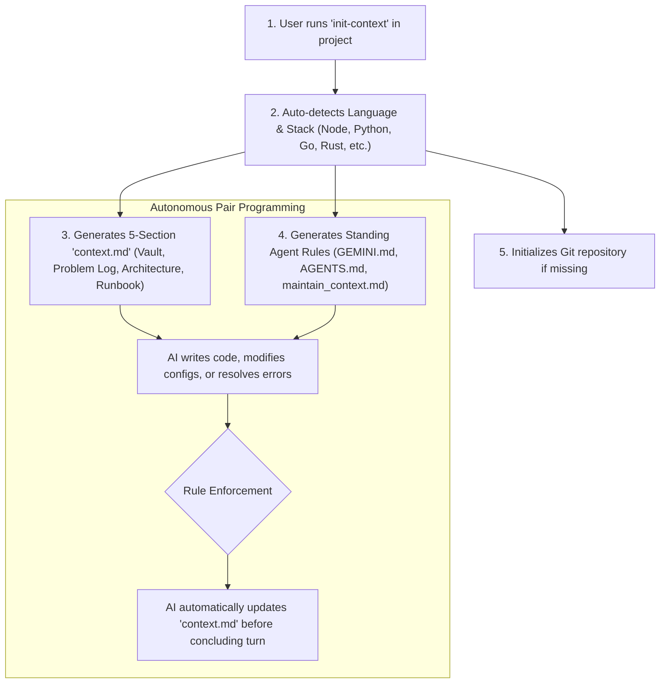

<div align="center">

# 🧠 Auto-Context

**Autonomous Context & Instruction Management Protocol for AI Coding Assistants**

[](https://opensource.org/licenses/MIT)
[](#-quick-one-line-install)
[](#-supported-ai-assistants)
[](https://github.com/Cyber-arghya/auto-context/pulls)

*Never lose context, forgotten architecture decisions, or unlogged bug fixes again.*

[English](#-english-documentation) • [বাংলা নির্দেশিকা](#-বাংলা-নির্দেশিকা-bengali-guide) • [Installation](#-quick-one-line-install) • [CLI Usage](#-cli-usage)

</div>

---

## ⚡ Quick One-Line Install

No manual downloads or complex PATH configurations required. Run the command matching your terminal:

### 🪟 Windows (PowerShell / `pwsh`):
```powershell
irm https://raw.githubusercontent.com/Cyber-arghya/auto-context/main/install.ps1 | iex
```

### 🐧 Linux / WSL2 / macOS (Bash / Zsh):
```bash
curl -sSL https://raw.githubusercontent.com/Cyber-arghya/auto-context/main/install.sh | bash
```

> **Note:** The installer automatically configures `init-context` in your user `PATH`, registers shell functions, and provisions the global **Antigravity AI Agent Plugin**.

---

## 🚀 CLI Usage

Inside any existing or brand new project folder, simply run:

```bash
# Navigate to your project
cd /path/to/any-project

# Initialize autonomous context tracking
init-context
```

### Options & Flags:
```text
init-context [OPTIONS] [DIRECTORY]

OPTIONS:
  -f, --force      Overwrite existing context.md and standing rule files
  -d, --dry-run    Preview generated structure without writing to disk
  -v, --version    Display current version
  -h, --help       Show help documentation
```

---

## 💡 How It Works



Whenever an AI coding assistant operates in an `auto-context` repository:
1. **Zero-User-Prompting Mandate:** You never have to remind the AI to update notes.
2. **Problem & Incident Vault:** Every bug, connection timeout, DNS issue, or build error is logged alongside its root cause and exact terminal commands used to fix it.
3. **Master Configuration Vault:** IPs, ports, usernames, API tokens, and environment parameters stay synchronized.
4. **Reproducibility:** A developer or fresh OS can reconstruct the environment using the embedded runbook.

---

## 📁 Generated Files Overview

| File | Purpose | Audience |
| :--- | :--- | :--- |
| [`context.md`](./templates/context.template.md) | Single Source of Truth: Credentials vault, architecture, problem logs, and reproduction runbook. | Developers & AI Agents |
| [`GEMINI.md`](./templates/GEMINI.template.md) | Project-level standing rule enforcing continuous autonomous synchronization. | Antigravity AI |
| [`AGENTS.md`](./templates/AGENTS.template.md) | Universal agent instruction file for non-Antigravity environments. | Cursor, Claude Code, Copilot, Windsurf |
| [`.agents/rules/maintain_context.md`](./templates/maintain_context.template.md) | Native Antigravity progressive disclosure rule (`trigger: always_on`). | Antigravity Rule Engine |

---

## 🤖 Supported AI Assistants

* **Google Antigravity IDE & CLI (`agy`)** *(Native full plugin support)*
* **Cursor AI** *(Reads `AGENTS.md` and `context.md`)*
* **Claude Code / Anthropic Agent**
* **GitHub Copilot Chat & Workspace**
* **Windsurf IDE (Codeium)**
* **Cline / Roo Code**

---

## 🇧🇩 বাংলা নির্দেশিকা (Bengali Guide)

### এটি কী এবং কেন প্রয়োজন?
আমরা যখন এআই অ্যাসিস্ট্যান্ট (Antigravity, Cursor, Claude Code) দিয়ে কোডিং বা সার্ভার কনফিগার করি, তখন কিছুক্ষণ পর এআই আগের কনফিগারেশন, সার্ভার আইপি বা পুরোনো এরর ভুলে যায়। 

**Auto-Context** আপনার প্রজেক্টের রুটে একটি স্বয়ংক্রিয় `context.md` এবং কিছু শক্তিশালী নিয়ম (Rules) সেট করে দেয়। ফলে:
1. **আপনাকে আর মনে করিয়ে দিতে হবে না:** এআই নিজে থেকেই প্রতি কাজের শেষে `context.md` ফাইল আপডেট করে দেবে।
2. **সমস্যার নিখুঁত সমাধান রেকর্ড থাকে:** টার্মিনালে কোনো এরর সমাধান করলে সেই এররটি কেন হয়েছিল এবং কী কমান্ড দিয়ে ঠিক করা হয়েছে তা চার্ট আকারে সেভ থাকবে।
3. **পাসওয়ার্ড ও পোর্ট ভল্ট:** সার্ভারের স্ট্যাটিক আইপি, ক্লাউডফ্লেয়ার টানেল আইডি বা ডাটাবেজ পোর্ট সবসময় এক ফাইলে নিখুঁতভাবে থাকবে।

### ইনস্টলেশন ও ব্যবহার:
* **উইন্ডোজ পাওয়ারশেল (PowerShell)-এ:**
  ```powershell
  irm https://raw.githubusercontent.com/Cyber-arghya/auto-context/main/install.ps1 | iex
  ```
* **লিনাক্স / WSL2-এ:**
  ```bash
  curl -sSL https://raw.githubusercontent.com/Cyber-arghya/auto-context/main/install.sh | bash
  ```
* **নতুন প্রজেক্টে ব্যবহার:**
  যেকোনো প্রজেক্ট ফোল্ডারে ঢুকে টার্মিনালে শুধু লিখুন:
  ```bash
  init-context
  ```
  ব্যস! আপনার প্রজেক্টে স্বয়ংক্রিয় কনটেক্সট ট্র্যাকিং চালু হয়ে যাবে।

---

## 📦 Repository Structure

```text
auto-context/
├── bin/
│   ├── init-context                 # POSIX Bash CLI executable
│   ├── init-context.ps1             # PowerShell native script
│   └── init-context.cmd             # Windows CMD launcher
├── plugin/                          # Antigravity Global Plugin bundle
│   ├── plugin.json                  # Manifest
│   ├── rules/AGENTS.md              # Global standing rule
│   └── skills/auto-context/SKILL.md # Progressive disclosure skill
├── templates/                       # Boilerplate templates
│   ├── context.template.md
│   ├── GEMINI.template.md
│   ├── AGENTS.template.md
│   └── maintain_context.template.md
├── install.sh                       # 1-Line remote installer (Linux / WSL2 / macOS)
├── install.ps1                      # 1-Line remote installer (Windows PowerShell)
├── setup.bat                        # Offline double-clickable installer
├── uninstall.sh                     # Clean uninstaller for POSIX
├── uninstall.ps1                    # Clean uninstaller for Windows
├── LICENSE                          # MIT License
└── README.md                        # Documentation
```

---

## 👤 Author

* **GitHub:** [@Cyber-arghya](https://github.com/Cyber-arghya)
* **Email:** [work.arghya01@gmail.com](mailto:work.arghya01@gmail.com)

---

## 📄 License

This project is open-source and licensed under the [MIT License](./LICENSE). Contributions and pull requests are warmly welcomed!
