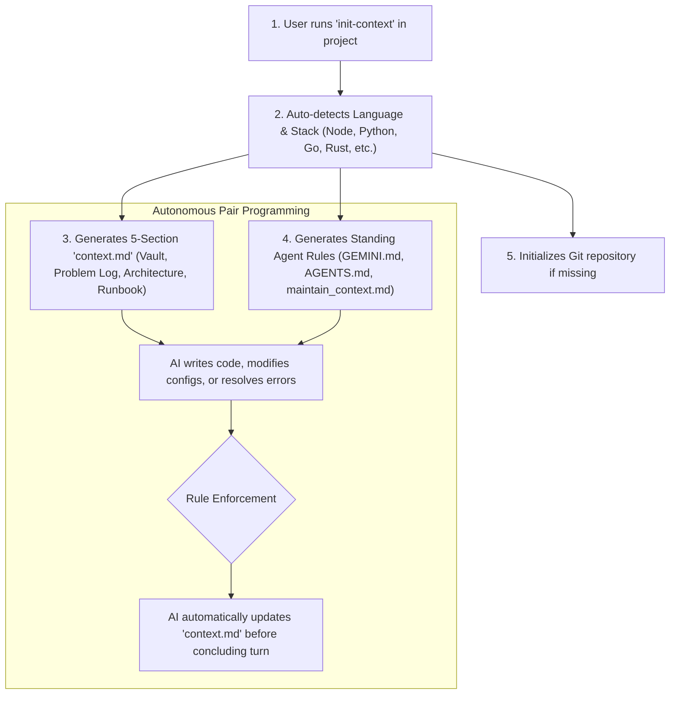

<div align="center">

# 🧠 Auto-Context

**Autonomous Context & Instruction Management Protocol for AI Coding Assistants**

[](https://opensource.org/licenses/MIT)
[](#-quick-one-line-install)
[](#-supported-ai-assistants)
[](https://github.com/Cyber-arghya/auto-context/pulls)

*Never lose context, forgotten architecture decisions, or unlogged bug fixes again.*

[English](#-english-documentation) • [বাংলা নির্দেশিকা](#-বাংলা-নির্দেশিকা-bengali-guide) • [Installation](#-quick-one-line-install) • [CLI Usage](#-cli-usage)

</div>

---

## ⚡ Quick One-Line Install

No manual downloads or complex PATH configurations required. Run the command matching your terminal:

### 🪟 Windows (PowerShell / `pwsh`):
```powershell
irm https://raw.githubusercontent.com/Cyber-arghya/auto-context/main/install.ps1 | iex
```

### 🐧 Linux / WSL2 / macOS (Bash / Zsh):
```bash
curl -sSL https://raw.githubusercontent.com/Cyber-arghya/auto-context/main/install.sh | bash
```

> **Note:** The installer automatically configures `init-context` in your user `PATH`, registers shell functions, and provisions the global **Antigravity AI Agent Plugin**.

---

## 🚀 CLI Usage

Inside any existing or brand new project folder, simply run:

```bash
# Navigate to your project
cd /path/to/any-project

# Initialize autonomous context tracking
init-context
```

### Options & Flags:
```text
init-context [OPTIONS] [DIRECTORY]

OPTIONS (CONTEXT & RULES):
  -r, --new-rule <NAME>     Scaffold a new rule file (.agents/rules/<name>.md)
  -s, --new-skill <NAME>    Scaffold a new skill folder (.agents/skills/<name>/SKILL.md)
  -g, --global              Target global plugin scope (~/.gemini/config/plugins/auto-context/)
  -f, --force               Overwrite existing context.md and standing rule files
  -d, --dry-run             Preview generated structure without writing to disk
  -v, --version             Display current version
  -h, --help                Show help documentation

OPTIONS (MCP TOOLING):
  --add-mcp <NAME>          Add or update an MCP server configuration
  --remove-mcp <NAME>       Remove an MCP server from configuration
  --list-mcp                List all active MCP server tools
  --preset <PRESET>         Preset template (sqlite, postgres, github, filesystem, brave, fetch)
  --command <CMD>           Executable command for stdio server (e.g. npx, uvx, python3)
  --args <ARGS>             Arguments to pass to command
  --url <URL>               Streamable HTTP endpoint URL for remote MCP server
  --env <KEY=VAL,...>       Environment variables (e.g. 'GITHUB_TOKEN=xyz')
```

---

## 🔌 MCP (Model Context Protocol) Tooling Management (টুল ম্যানেজমেন্ট)

Auto-Context allows you and your AI agents to seamlessly install, update, list, and delete **MCP servers** with single commands:

### 1️⃣ Add Popular Pre-configured MCP Servers (Secure Secret Pattern)
Tokens and connection strings are **never stored as plaintext** in config files or committed to Git. Instead, they reference environment variables (`${VAR_NAME}`), automatically create safe placeholders in `.env.example`, and protect `.env` in `.gitignore`:

```bash
# Add SQLite database query tool (local file)
init-context --add-mcp sqlite --args "database.db"

# Add PostgreSQL tool (securely references ${DATABASE_URL} from .env)
init-context --add-mcp postgres

# Add GitHub API tool (securely references ${GITHUB_PERSONAL_ACCESS_TOKEN} from .env)
init-context --add-mcp github

# Add Brave Search tool (securely references ${BRAVE_API_KEY} from .env)
init-context --add-mcp brave

# Customize which environment variable holds the secret
init-context --add-mcp github --env-var MY_CUSTOM_GH_TOKEN
```

### 2️⃣ Add Custom Stdio or Remote HTTP MCP Servers
```bash
# Add custom Python/Node MCP server
init-context --add-mcp my-tool --command "python3" --args "server.py"

# Add remote Streamable HTTP MCP server
init-context --add-mcp remote-api --url "https://mcp.mycompany.com/mcp"
```

### 3️⃣ List and Delete MCP Tools
```bash
# List all active project or global MCP tools
init-context --list-mcp
init-context --list-mcp -g

# Remove an MCP tool
init-context --remove-mcp sqlite
init-context --remove-mcp github -g
```

---

## 🛠️ Adding Custom Skills & Rules (কাস্টম স্কিল ও রুল যুক্ত করার নিয়ম)

You can easily teach your AI assistants new abilities (**Skills**) or enforce custom guidelines (**Rules**), either for a **single project (Local)** or across your **entire computer (Global)**.

### 🧠 Skills vs. Rules: What is the Difference?

| Type | Purpose | When Active | Format / Location |
| :--- | :--- | :--- | :--- |
| **Rule** | Behavioral constraints, coding standards, security boundaries, or test requirements. | Always active (`trigger: always_on`) or context-triggered. | `.agents/rules/<name>.md` or `GEMINI.md` |
| **Skill** | Step-by-step procedures, deployment runbooks, debugging steps, or CLI tool guides. | Activated on-demand when relevant task is requested. | `.agents/skills/<name>/SKILL.md` |

---

### 1️⃣ How to Add a New Rule

#### Method A: Using 1-Command CLI (Recommended)
```bash
# In Bash / WSL2 / macOS:
init-context -r code-style              # Create local rule for active project
init-context -r security-policy --global # Create global rule for ALL projects

# In Windows PowerShell:
init-context -NewRule code-style
init-context -NewRule security-policy -Global
```

#### Method B: Manual File Creation
Create a file at `.agents/rules/my-rule.md`:
```markdown
---
name: my-rule
description: Enforce TypeScript strict null checks and ESLint formatting.
trigger: always_on
---

# Rule: TypeScript & Formatting Standards

## Guidelines
- Never use 'any' type in production code.
- Run 'npm run lint' before finalizing any changes.
```

---

### 2️⃣ How to Add a New Skill

#### Method A: Using 1-Command CLI (Recommended)
```bash
# In Bash / WSL2 / macOS:
init-context -s deploy-docker           # Create local skill for active project
init-context -s server-diagnostics -g   # Create global skill for ALL projects

# In Windows PowerShell:
init-context -NewSkill deploy-docker
init-context -NewSkill server-diagnostics -Global
```

#### Method B: Manual File Creation
Create a folder and file at `.agents/skills/deploy-docker/SKILL.md`:
```markdown
---
name: deploy-docker
description: Step-by-step procedure to build and deploy dockerized containers.
---

# Skill: Docker Deployment Runbook

## When to Activate
- When the user asks to build, run, or deploy Docker containers.

## Step-by-Step Procedure
1. Build the production image:
   ```bash
   docker compose build --no-cache
   ```
2. Run health check on containers:
   ```bash
   docker compose ps
   ```
```

---

### 3️⃣ Local vs. Global Scopes

* **Local Scope (`.agents/`):**
  * Stored inside your project folder (`.agents/rules/` and `.agents/skills/`).
  * Can be committed to Git so teammates and CI/CD share the exact same rules.
* **Global Scope (`~/.gemini/config/plugins/auto-context/`):**
  * Stored machine-wide.
  * Every single project opened in Antigravity automatically inherits these skills and rules.

---

## 💡 How It Works



Whenever an AI coding assistant operates in an `auto-context` repository:
1. **Zero-User-Prompting Mandate:** You never have to remind the AI to update notes.
2. **Problem & Incident Vault:** Every bug, connection timeout, DNS issue, or build error is logged alongside its root cause and exact terminal commands used to fix it.
3. **Master Configuration Vault:** IPs, ports, usernames, API tokens, and environment parameters stay synchronized.
4. **Reproducibility:** A developer or fresh OS can reconstruct the environment using the embedded runbook.

---

## 📁 Generated Files Overview

| File | Purpose | Audience |
| :--- | :--- | :--- |
| [`context.md`](./templates/context.template.md) | Single Source of Truth: Credentials vault, architecture, problem logs, and reproduction runbook. | Developers & AI Agents |
| [`GEMINI.md`](./templates/GEMINI.template.md) | Project-level standing rule enforcing continuous autonomous synchronization. | Antigravity AI |
| [`AGENTS.md`](./templates/AGENTS.template.md) | Universal agent instruction file for non-Antigravity environments. | Cursor, Claude Code, Copilot, Windsurf |
| [`.agents/rules/maintain_context.md`](./templates/maintain_context.template.md) | Native Antigravity progressive disclosure rule (`trigger: always_on`). | Antigravity Rule Engine |

---

## 🤖 Supported AI Assistants

* **Google Antigravity IDE & CLI (`agy`)** *(Native full plugin support)*
* **Cursor AI** *(Reads `AGENTS.md` and `context.md`)*
* **Claude Code / Anthropic Agent**
* **GitHub Copilot Chat & Workspace**
* **Windsurf IDE (Codeium)**
* **Cline / Roo Code**

---

## 🇧🇩 বাংলা নির্দেশিকা (Bengali Guide)

### এটি কী এবং কেন প্রয়োজন?
আমরা যখন এআই অ্যাসিস্ট্যান্ট (Antigravity, Cursor, Claude Code) দিয়ে কোডিং বা সার্ভার কনফিগার করি, তখন কিছুক্ষণ পর এআই আগের কনফিগারেশন, সার্ভার আইপি বা পুরোনো এরর ভুলে যায়। 

**Auto-Context** আপনার প্রজেক্টের রুটে একটি স্বয়ংক্রিয় `context.md` এবং কিছু শক্তিশালী নিয়ম (Rules) সেট করে দেয়। ফলে:
1. **আপনাকে আর মনে করিয়ে দিতে হবে না:** এআই নিজে থেকেই প্রতি কাজের শেষে `context.md` ফাইল আপডেট করে দেবে।
2. **সমস্যার নিখুঁত সমাধান রেকর্ড থাকে:** টার্মিনালে কোনো এরর সমাধান করলে সেই এররটি কেন হয়েছিল এবং কী কমান্ড দিয়ে ঠিক করা হয়েছে তা চার্ট আকারে সেভ থাকবে।
3. **পাসওয়ার্ড ও পোর্ট ভল্ট:** সার্ভারের স্ট্যাটিক আইপি, ক্লাউডফ্লেয়ার টানেল আইডি বা ডাটাবেজ পোর্ট সবসময় এক ফাইলে নিখুঁতভাবে থাকবে।

### ইনস্টলেশন ও ব্যবহার:
* **উইন্ডোজ পাওয়ারশেল (PowerShell)-এ:**
  ```powershell
  irm https://raw.githubusercontent.com/Cyber-arghya/auto-context/main/install.ps1 | iex
  ```
* **লিনাক্স / WSL2-এ:**
  ```bash
  curl -sSL https://raw.githubusercontent.com/Cyber-arghya/auto-context/main/install.sh | bash
  ```
* **নতুন প্রজেক্টে ব্যবহার:**
  যেকোনো প্রজেক্ট ফোল্ডারে ঢুকে টার্মিনালে শুধু লিখুন:
  ```bash
  init-context
  ```
  ব্যস! আপনার প্রজেক্টে স্বয়ংক্রিয় কনটেক্সট ট্র্যাকিং চালু হয়ে যাবে।

### নতুন স্কিল বা রুল তৈরি করার নিয়ম:
* **নতুন রুল (Rule) তৈরি করতে:**
  ```bash
  init-context -r my-rule-name       # বর্তমান প্রজেক্টের জন্য
  init-context -r my-rule-name -g    # সকল প্রজেক্টের জন্য গ্লোবালি
  ```
* **নতুন স্কিল (Skill) তৈরি করতে:**
  ```bash
  init-context -s my-skill-name      # বর্তমান প্রজেক্টের জন্য
  init-context -s my-skill-name -g   # সকল প্রজেক্টের জন্য গ্লোবালি
  ```

### নিরাপদ MCP টুল ম্যানেজমেন্ট (Secure Secrets via .env):
টোকেন বা পাসওয়ার্ড কখনোই কনফিগ ফাইলে ওপেন টেক্সটে সেভ হয় না, বরং `.env` এবং `.gitignore`-এর মাধ্যমে নিরাপদ থাকে:
* **টুল যুক্ত করতে:**
  ```bash
  init-context --add-mcp sqlite             # SQLite লোকাল ডাটাবেজ
  init-context --add-mcp github             # GitHub API (.env থেকে টোকেন পড়বে)
  init-context --add-mcp postgres           # PostgreSQL (.env থেকে DATABASE_URL পড়বে)
  ```
* **টুল তালিকা দেখতে ও মুছতে:**
  ```bash
  init-context --list-mcp                   # সক্রিয় টুল দেখতে
  init-context --remove-mcp github          # টুল মুছে ফেলতে
  ```

---

## 📦 Repository Structure

```text
auto-context/
├── bin/
│   ├── init-context                 # POSIX Bash CLI executable
│   ├── init-context.ps1             # PowerShell native script
│   └── init-context.cmd             # Windows CMD launcher
├── plugin/                          # Antigravity Global Plugin bundle
│   ├── plugin.json                  # Manifest
│   ├── rules/AGENTS.md              # Global standing rule
│   └── skills/auto-context/SKILL.md # Progressive disclosure skill
├── templates/                       # Boilerplate templates
│   ├── context.template.md
│   ├── GEMINI.template.md
│   ├── AGENTS.template.md
│   └── maintain_context.template.md
├── install.sh                       # 1-Line remote installer (Linux / WSL2 / macOS)
├── install.ps1                      # 1-Line remote installer (Windows PowerShell)
├── setup.bat                        # Offline double-clickable installer
├── uninstall.sh                     # Clean uninstaller for POSIX
├── uninstall.ps1                    # Clean uninstaller for Windows
├── LICENSE                          # MIT License
└── README.md                        # Documentation
```

---

## 👤 Author

* **GitHub:** [@Cyber-arghya](https://github.com/Cyber-arghya)
* **Email:** [work.arghya01@gmail.com](mailto:work.arghya01@gmail.com)

---

## 📄 License

This project is open-source and licensed under the [MIT License](./LICENSE). Contributions and pull requests are warmly welcomed!

