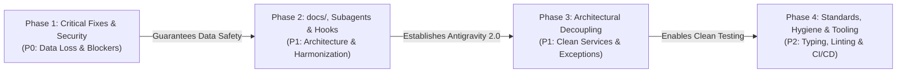

 # 🚀 Comprehensive Implementation Plan: Auto-Context Hardening & Modernization

> **Document:** `implement-plan-1.md`  
> **Repository:** `auto-context` (`auto-context-cli`)  
> **Target Version:** `1.5.2` / `2.0.0`  
> **Status:** Final Implementation Plan (Updated with Antigravity 2.0 & `docs/` Architecture)  

---

## 1. Executive Summary

### 1.1 Scope
* **In-Scope Components:**
  - **CLI Core & Routing:** [`src/auto_context/main.py`](file:///c:/Users/worka/Desktop/test/auto-context/src/auto_context/main.py), [`config.py`](file:///c:/Users/worka/Desktop/test/auto-context/src/auto_context/config.py), and [`security.py`](file:///c:/Users/worka/Desktop/test/auto-context/src/auto_context/security.py).
  - **Command Engines:**
    - [`commands/init_cmd.py`](file:///c:/Users/worka/Desktop/test/auto-context/src/auto_context/commands/init_cmd.py) (`init`, `rule`, `skill`, `agent`, `promote`, duplicate registry).
    - [`commands/update_cmd.py`](file:///c:/Users/worka/Desktop/test/auto-context/src/auto_context/commands/update_cmd.py) (upstream sync, caching, self-updater).
    - [`commands/memory.py`](file:///c:/Users/worka/Desktop/test/auto-context/src/auto_context/commands/memory.py) (git operations, harvesting, sync).
    - [`commands/import_cmd.py`](file:///c:/Users/worka/Desktop/test/auto-context/src/auto_context/commands/import_cmd.py) (gist/raw resolution, collision management).
    - [`commands/mcp.py`](file:///c:/Users/worka/Desktop/test/auto-context/src/auto_context/commands/mcp.py) (JSON registries, preset runners, env safety).
  - **Documentation & Knowledge Architecture (`docs/`):**
    - Transition from hidden `.agents/context/` satellites to standard `docs/` layout:
      - `docs/architecture/` (`system-design.md`, `database-schema.md`, `api-design.md`).
      - `docs/development/` (`development-guide.md`).
      - `docs/decisions/` (`ADR-001.md`).
  - **Agent Steering Engine (`.agents/`):**
    - `.agents/rules/` (Constitutional coding standards & security).
    - `.agents/skills/` (Reusable operational workflows & runbooks).
    - `.agents/agents/` 🌟 *(New: Specialized Subagent Roles for Antigravity: Architect, Reviewer, Security).*
    - `.agents/hooks/` 🌟 *(New: Deterministic lifecycle execution scripts: format, lint, validate).*
  - **Triple Instruction Harmonization:**
    - Primary Antigravity native directive: `GEMINI.md`.
    - Universal open-agent standard directive: `AGENTS.md`.
    - Cross-agent interoperable mirror: `CLAUDE.md`.
  - **CI/CD & Automation:** [`.github/workflows/test.yml`](file:///c:/Users/worka/Desktop/test/auto-context/.github/workflows/test.yml), [`tests/run_tests.py`](file:///c:/Users/worka/Desktop/test/auto-context/tests/run_tests.py), and [`pyproject.toml`](file:///c:/Users/worka/Desktop/test/auto-context/pyproject.toml).
* **Strict Out-of-Scope Boundaries:**
  - **Zero Data Loss Guarantee:** Never alter or overwrite user-created custom rules (`.agents/rules/*.md`) or local environment configs (`.env`, `context.local.md`).
  - `docs/` files are public project assets intended for Git tracking, while `.agents/` remains protected under zero-footprint local exclusions where appropriate.

### 1.2 Main Goals
1. **Zero Data Loss Guarantee:** Eliminate the critical bug where passing `--force` with `--append` wiped out rule files.
2. **0ms Deterministic Offline Execution:** Implement Negative Caching in the upstream checker to permanently remove the 4-second synchronous terminal delay in offline/firewalled environments.
3. **Transition to Standard `docs/` Knowledge Layout:** Replace `.agents/context/` with human-readable, Git-first `docs/` directories (`architecture/`, `development/`, `decisions/`).
4. **Antigravity Specialized Subagents (`.agents/agents/`):** Introduce first-class scaffolding for modular subagent personas compatible with Antigravity (`invoke_subagent` / `define_subagent`).
5. **Deterministic Lifecycle Hooks (`.agents/hooks/`):** Provide automated pre-verification and formatting hooks (`format.sh`, `validate.sh`, `format.ps1`, `validate.ps1`).
6. **Triple Instruction Harmonization:** Ensure identical, synchronized instruction routing across `GEMINI.md`, `AGENTS.md`, and `CLAUDE.md`.
7. **100% CI/CD Pipeline Recovery:** Update GitHub Actions test scripts to assert current architecture paths, eliminating test drift failures.
8. **Clean Architecture & Decoupled Domain Services:** Extract core business logic from Typer CLI controllers into a reusable, type-safe Python SDK/service layer.

### 1.3 Recommended Execution Order



* **Rationale:** Phase 1 fixes critical data loss and CLI crashes. Phase 2 introduces the new `docs/` structure, `.agents/agents/`, `.agents/hooks/`, and triple instructions. Phase 3 decouples services, and Phase 4 locks in quality with automated static analysis and CI/CD tests.

---

## 2. Phase Breakdown

```mermaid
gantt
    title Phased Implementation Timeline & Priority
    dateFormat  X
    axisFormat %s
    section Phase 1 (P0)
    Critical Fixes & Security Hardening       :p1, 0, 1
    section Phase 2 (P1)
    docs/ Architecture, Subagents & Hooks     :p2, 1, 2
    section Phase 3 (P1)
    Architectural Decoupling & Services       :p3, 2, 3
    section Phase 4 (P2)
    Standards, Hygiene & CI/CD Tooling        :p4, 3, 4
```



---

### Phase 1: Critical Fixes & Security Hardening

#### Goal & Priority
* **Priority:** **P0 Blocker**
* **Primary Goal:** Eliminate catastrophic data loss, CLI flag conflicts, process crashes, offline terminal freezes, and security scanner bypasses.

#### Action Items (Checklist)
- [x] **Fix Rule File Truncation on Append:** Modify `new_rule()` in [`src/auto_context/commands/init_cmd.py`](file:///c:/Users/worka/Desktop/test/auto-context/src/auto_context/commands/init_cmd.py#L440-L476).
- [x] **Implement Negative Upstream Caching:** Update `get_cached_update_status()` in [`src/auto_context/commands/update_cmd.py`](file:///c:/Users/worka/Desktop/test/auto-context/src/auto_context/commands/update_cmd.py#L100-L141).
- [x] **Repair Broken GitHub Actions CI Workflow:** Update test path assertions in [`.github/workflows/test.yml`](file:///c:/Users/worka/Desktop/test/auto-context/.github/workflows/test.yml#L45-L51).
- [x] **Resolve CLI Short Flag Collision:** Change `--args` short flag from `-a` to `-A` in [`src/auto_context/main.py`](file:///c:/Users/worka/Desktop/test/auto-context/src/auto_context/main.py#L50).
- [x] **Handle Git Pull Subprocess Crashes Gracefully:** Catch `subprocess.CalledProcessError` in [`src/auto_context/commands/memory.py`](file:///c:/Users/worka/Desktop/test/auto-context/src/auto_context/commands/memory.py#L360-L375).
- [x] **Fix Case-Insensitive Secret Scanner Bypass:** Normalize filenames with `.lower()` in [`src/auto_context/security.py`](file:///c:/Users/worka/Desktop/test/auto-context/src/auto_context/security.py#L88).
- [x] **Prevent Secret Redaction Leakage in Reports:** Mask assigned secret values rather than the entire assignment statement in [`src/auto_context/security.py`](file:///c:/Users/worka/Desktop/test/auto-context/src/auto_context/security.py#L74-L78).

#### Technical Implementation Guide

##### 1. Rule Append Safety (`src/auto_context/commands/init_cmd.py`)
Decouple `append` handling from the `not force` branch:
```python
    if dest_file.exists():
        if append or guideline:
            text_to_append = guideline or "New domain constraint and best practice."

            # Only check duplicate collision if --force is absent
            if not force:
                dup = _find_duplicate_rule(_load_registry(registry_file), text_to_append)
                if dup:
                    dup_domain, dup_title, dup_file = dup
                    console.print(Panel(
                        f"[bold yellow]⚠️ Duplicate Rule Detected — Skipped![/]\n"
                        f"[white]Guideline matches '[green]{dup_title}[/]' in [yellow]{dup_file}[/].\n"
                        f"[dim]Use --force to append anyway.[/]",
                        border_style="yellow",
                    ))
                    return

            if not dry_run:
                _append_guideline_to_file(dest_file, text_to_append)
                _register_rule_in_registry(registry_file, clean_name, text_to_append, dest_file.name)
                if global_ and config.MEMORY_DIR.exists():
                    mem_dest = config.MEMORY_DIR / "rules" / f"{clean_name}.md"
                    if mem_dest.exists():
                        _append_guideline_to_file(mem_dest, text_to_append)
                        _register_rule_in_registry(config.MEMORY_DIR / "rules" / "registry.json", clean_name, text_to_append, dest_file.name)
            console.print(Panel(
                f"[bold green]✨ Rule Domain Updated & Registered![/]\n"
                f"[yellow]   Rule:[/]     {clean_name}\n"
                f"[cyan]   File:[/]     {dest_file}\n"
                f"[green]   Added:[/]    {text_to_append}",
                border_style="green",
            ))
            return

        if not force:
            console.print(f"[yellow][!] Rule already exists:[/] {dest_file}\n    Use --append (-a) with --guideline to add, or --force to overwrite.")
            raise typer.Exit(1)
```

##### 2. Negative Caching (`src/auto_context/commands/update_cmd.py`)
Ensure network failures save a timestamped cache entry:
```python
    upstream = check_upstream_version(timeout=1.2)
    current_v = get_installed_version()
    latest_v = upstream["latest_version"] if upstream else current_v
    update_available = (_parse_version(latest_v) > _parse_version(current_v)) if upstream else False

    cache_data = {
        "timestamp": now,
        "current_version": current_v,
        "latest_version": latest_v,
        "update_available": update_available,
        "source": upstream.get("source") if upstream else "offline_fallback",
    }
    try:
        cache_file.parent.mkdir(parents=True, exist_ok=True)
        cache_file.write_text(json.dumps(cache_data, indent=2), encoding="utf-8")
    except Exception:
        pass
```

##### 3. Case-Insensitive Security Check (`src/auto_context/security.py`)
```python
    name_lower = path.name.lower()
    if name_lower in PROHIBITED_FILES or name_lower.startswith(".env."):
        return [Violation(path, 0, "Prohibited Sensitive File", path.name)]
```

#### Risks & Rollback Strategy
* **Risk:** Negative cache could delay notifications if connectivity is restored immediately.
* **Mitigation:** `init-context update --check` explicitly uses `force_check=True`, invalidating the cache on demand.
* **Rollback:** Standard git commit revert on Phase 1 commits.

---

### Phase 2: `docs/` Knowledge Layout, Subagents, Hooks & Harmonization

#### Goal & Priority
* **Priority:** **P1 Architecture & Antigravity 2.0 Modernization**
* **Primary Goal:** Transition from `.agents/context/` to standard `docs/`, implement Antigravity subagent scaffolding (`.agents/agents/`), automated lifecycle hooks (`.agents/hooks/`), and triple instruction harmonization (`GEMINI.md`, `AGENTS.md`, `CLAUDE.md`).

#### Action Items (Checklist)
- [x] **Scaffold Standard `docs/` Knowledge Layout:**
  - Create `docs/architecture/` (`system-design.md`, `database-schema.md`, `api-design.md`).
  - Create `docs/development/` (`development-guide.md`).
  - Create `docs/decisions/` (`ADR-001.md`).
  - Automatically migrate legacy `.agents/context/` files (`routes.md` $\to$ `api-design.md`, `schema.md` $\to$ `database-schema.md`, `gotchas.md` $\to$ `development-guide.md`).
- [x] **Implement Subagent Persona Directory (`.agents/agents/`):**
  - Add CLI command: `init-context agent <role-name>` (e.g. `init-context agent architect`).
  - Scaffold default Antigravity subagent role templates:
    - `architect.md` (System design & architectural trade-offs).
    - `code-reviewer.md` (PR review, static analysis & quality gate).
    - `security-auditor.md` (Secret scan, auth boundaries & vulnerability check).
- [x] **Implement Deterministic Lifecycle Hooks (`.agents/hooks/`):**
  - Scaffold cross-platform executable hooks:
    - `format.sh` / `format.ps1` (Deterministic code formatter).
    - `validate.sh` / `validate.ps1` (Pre-commit / Pre-verification test gate).
- [x] **Triple Instruction Harmonization:**
  - Generate synchronized entrypoints pointing cleanly to `docs/` and `.agents/`:
    - `GEMINI.md` (Google Antigravity & Gemini CLI primary directive).
    - `AGENTS.md` (Universal Open Agent standard).
    - `CLAUDE.md` (Claude Code cross-agent interoperable mirror).
- [x] **Recursive Multi-File Skill Tree Sync:** Replace `shutil.copy2` with `shutil.copytree` in [`commands/init_cmd.py`](file:///c:/Users/worka/Desktop/test/auto-context/src/auto_context/commands/init_cmd.py) and [`commands/memory.py`](file:///c:/Users/worka/Desktop/test/auto-context/src/auto_context/commands/memory.py).
- [x] **Resilient Gist URL Resolution:** Handle anchors (`#file-...`) and trailing slashes in [`commands/import_cmd.py`](file:///c:/Users/worka/Desktop/test/auto-context/src/auto_context/commands/import_cmd.py).
- [x] **Auto-Register Newly Scaffolded Rules:** Call `_register_rule_in_registry` on initial rule creation.
- [x] **Filter Stop-Words in Duplicate Checker:** Refine `_find_duplicate_rule()` with threshold $\ge 3$.
- [x] **Normalize Windows Path URIs:** Pass `project_dir.as_posix()` into template variables.
- [x] **Guard MCP JSON Config Handlers:** Prevent `KeyError` on empty dictionaries and iterate all active MCP files.

#### Technical Implementation Guide

##### 1. `docs/` Knowledge Architecture Scaffolding & Migration (`commands/init_cmd.py`)
```python
DOCS_SUBDIRS = [
    "architecture",
    "development",
    "decisions",
]

def _scaffold_docs_layout(project_dir: Path, variables: dict[str, str], force: bool, dry_run: bool) -> None:
    docs_root = project_dir / "docs"
    templates_dir = get_templates_dir() / "docs"

    for sub in DOCS_SUBDIRS:
        (docs_root / sub).mkdir(parents=True, exist_ok=True)

    # Legacy migration: .agents/context/ -> docs/
    legacy_context = project_dir / AGENTS_SUBDIR / "context"
    if legacy_context.exists():
        legacy_mappings = [
            (legacy_context / "routes.md", docs_root / "architecture" / "api-design.md"),
            (legacy_context / "schema.md", docs_root / "architecture" / "database-schema.md"),
            (legacy_context / "gotchas.md", docs_root / "development" / "development-guide.md"),
        ]
        for src, dest in legacy_mappings:
            if src.exists() and not dest.exists() and not dry_run:
                shutil.copy2(src, dest)
                console.print(f"  [green][✓] Migrated:[/] {src} -> {dest}")
```

##### 2. Subagent Persona Scaffolding (`.agents/agents/`)
```python
@app.command("agent")
def new_agent(
    name: Annotated[str, typer.Argument(help="Subagent role name (e.g. architect, code-reviewer).")],
    target: Annotated[Optional[Path], typer.Option("--target", "-t")] = None,
    global_: Annotated[bool, typer.Option("--global", "-g")] = False,
    force: Annotated[bool, typer.Option("--force", "-f")] = False,
    dry_run: Annotated[bool, typer.Option("--dry-run", "-d")] = False,
) -> None:
    """Scaffold a specialized AI subagent persona for Antigravity."""
    clean_name = name.lower().replace(" ", "-").replace("_", "-").removesuffix(".md")
    dest_dir = (
        config.GLOBAL_PLUGIN_DIR / "agents"
        if global_
        else (target or Path.cwd()).resolve() / AGENTS_SUBDIR / "agents"
    )
    dest_file = dest_dir / f"{clean_name}.md"
    
    tmpl = get_templates_dir() / "agent.template.md"
    content = _render(tmpl, {"AGENT_ROLE": clean_name.replace("-", " ").title(), "AGENT_NAME": clean_name})
    _write_if_missing(dest_file, content, force=force, dry_run=dry_run)
    console.print(f"  [green][✓] Scaffolded Antigravity Subagent Persona:[/] {dest_file}")
```

##### 3. Triple Instruction Harmonization Template (`GEMINI.md` / `AGENTS.md` / `CLAUDE.md`)
```markdown
# Project Instructions for AI Assistants (Antigravity / Gemini / Claude)

## 1. Project Knowledge Base Index (`docs/`)
When answering questions or performing development tasks, inspect the designated document in `docs/`:
- **System Architecture & Dataflow:** `docs/architecture/system-design.md`
- **Database Schema & Models:** `docs/architecture/database-schema.md`
- **API Contracts & Endpoints:** `docs/architecture/api-design.md`
- **Development Toolchain & Gotchas:** `docs/development/development-guide.md`
- **Architecture Decision Records:** `docs/decisions/ADR-*.md`

## 2. Constitutional Guardrails (`.agents/rules/`)
Follow all active domain rules in `.agents/rules/*.md`:
- `code-standards.md`: Defensive programming, early returns, type annotations.
- `security-boundaries.md`: Zero hardcoded secrets, dummy credentials for local sandbox.
- `readme-docs-sync.md`: Parity between code options and documentation.

## 3. Operational Skills & Runbooks (`.agents/skills/`)
Execute matching tasks using reusable operational workflows:
- `docker-ops`: Multi-stage Docker builds and diagnostics.
- `git-workflow`: Semantic conventional commits and release tagging.
- `feature-verification`: Mandatory test execution and verification report.

## 4. Specialized Subagents (`.agents/agents/`)
Delegate tasks to specialized personas when appropriate:
- `architect.md`: System design and API contract definition.
- `code-reviewer.md`: Pull request review and quality audit.
- `security-auditor.md`: Credential audit and vulnerability review.

## 5. Lifecycle Hooks (`.agents/hooks/`)
Execute validation hooks before concluding tasks:
- Windows: `powershell -File .agents/hooks/validate.ps1`
- POSIX: `bash .agents/hooks/validate.sh`
```

#### Risks & Rollback Strategy
* **Risk:** Existing users expecting `.agents/context/` might be confused by the shift to `docs/`.
* **Mitigation:** The migration function preserves legacy files by copying them to `docs/` rather than deleting them immediately, with a clear migration notice printed to the console.
* **Rollback:** File-level git revert restores `.agents/context/` scaffolding.

---

### Phase 3: Architectural Decoupling, Services & Error Standards

#### Goal & Priority
* **Priority:** **P1 Architecture**
* **Primary Goal:** Eliminate the Fat Controller anti-pattern, establish a formal Domain/Service architecture, remove raw `sys.exit` calls, and eliminate silent exception swallowing.

#### Action Items (Checklist)
- [x] **Create Domain Exception Hierarchy:** Define [`src/auto_context/core/exceptions.py`](file:///c:/Users/worka/Desktop/test/auto-context/src/auto_context/core/exceptions.py).
- [x] **Create Domain Entities & Protocols:** Define [`src/auto_context/core/models.py`](file:///c:/Users/worka/Desktop/test/auto-context/src/auto_context/core/models.py).
- [x] **Extract Application Services:**
  - `src/auto_context/services/scaffold_service.py` (Scaffolding, `docs/` layout, git exclusion).
  - `src/auto_context/services/registry_service.py` (Rule indexing, duplicate matching).
  - `src/auto_context/services/memory_service.py` (Memory harvesting, commit, push, pull).
  - `src/auto_context/services/security_service.py` (Secret scanning, audit violations).
- [x] **Refactor Typer Commands to Thin Controllers:** Route CLI actions through services and handle domain exceptions at the top level.
- [x] **Eliminate Bare `except Exception: pass`:** Introduce structured debug logging (`logger.debug`) across all non-fatal handlers.

#### Technical Implementation Guide

##### 1. Domain Exception Hierarchy (`src/auto_context/core/exceptions.py`)
```python
class AutoContextError(Exception):
    """Base exception for all auto-context domain errors."""

class SecurityViolationError(AutoContextError):
    def __init__(self, violations: list):
        self.violations = violations
        super().__init__(f"Security audit blocked execution: {len(violations)} violation(s) found.")

class DuplicateRuleError(AutoContextError):
    def __init__(self, title: str, domain: str, file_name: str):
        self.title = title
        self.domain = domain
        self.file_name = file_name
        super().__init__(f"Duplicate rule conflict in '{domain}' ({file_name}): '{title}'")

class MemorySyncError(AutoContextError):
    """Raised when git push, pull, or init operations fail in Central Memory."""

class ConfigurationCorruptError(AutoContextError):
    """Raised when mcp_config.json contains unparseable or malformed structures."""
```

##### 2. Service Layer Refactoring Pattern
```python
# Thin Typer Controller in commands/init_cmd.py
@app.command("rule")
def new_rule_controller(name: str, target: Optional[Path] = None, force: bool = False, ...):
    service = RegistryService(target_dir=target)
    try:
        service.create_or_append_rule(name=name, force=force, guideline=guideline, ...)
    except DuplicateRuleError as err:
        console.print(Panel(f"[yellow]⚠️ {err}[/]", border_style="yellow"))
        raise typer.Exit(1)
    except AutoContextError as err:
        console.print(f"[red][✗] Error:[/] {err}")
        raise typer.Exit(1)
```

#### Risks & Rollback Strategy
* **Risk:** Service extraction could alter existing CLI argument defaults.
* **Mitigation:** Maintain identical `@app.command()` signatures and decorators.
* **Rollback:** Incremental commit reverts on service modules.

---

### Phase 4: Standards, Hygiene & CI/CD Modernization

#### Goal & Priority
* **Priority:** **P2 Standards & Hygiene**
* **Primary Goal:** Enforce strict type annotations (PEP 604), bound dependencies, automate static analysis, and support machine-readable CLI outputs.

#### Action Items (Checklist)
- [x] **Modernize Type Annotations:** Replace `Optional[T]` with `T | None` (PEP 604).
- [x] **Set Semantic Upper Bounds in Dependencies:** Update [`pyproject.toml`](file:///c:/Users/worka/Desktop/test/auto-context/pyproject.toml#L9-L14).
- [x] **Integrate Machine-Readable Output:** Implement `--json` support for `mcp list` and `memory status`.
- [x] **Add Static Analysis & Type Checking to CI:** Integrate `ruff` and `mypy` into [`.github/workflows/test.yml`](file:///c:/Users/worka/Desktop/test/auto-context/.github/workflows/test.yml).
- [x] **Synchronize Documentation & Satellites:** Update `README.md` and `.agents/context/` with modern syntax (`-A` flag, `docs/` layout, `--json`).

#### Technical Implementation Guide

##### 1. Dependency Bounds (`pyproject.toml`)
```toml
dependencies = [
    "typer>=0.12.0,<1.0.0",
    "rich>=13.0.0,<14.0.0",
    "python-dotenv>=1.0.0,<2.0.0",
    "httpx>=0.27.0,<1.0.0",
]

[dependency-groups]
dev = [
    "pytest>=8.0.0",
    "pytest-cov>=5.0.0",
    "pytest-mock>=3.12.0",
    "ruff>=0.4.0",
    "mypy>=1.10.0",
]
```

##### 2. CI Workflow Static Analysis Steps (`.github/workflows/test.yml`)
```yaml
      - name: Lint and Format with Ruff
        run: uv run ruff check src/ tests/

      - name: Static Type Check with Mypy
        run: uv run mypy src/ --ignore-missing-imports
```

#### Risks & Rollback Strategy
* **Risk:** `mypy` strict mode could flag legacy dynamic typing in templates.
* **Mitigation:** Use `--ignore-missing-imports` and incrementally enable strict flags.
* **Rollback:** Non-breaking CI adjustments.

---

## 3. Verification & Testing

Every task in this plan must be verified with executable test cases and manual CLI checks.

### 3.1 Unit & Integration Test Suite (`tests/`)

| Test File | Target Functionality | Verification Scenario & Assertions |
| :--- | :--- | :--- |
| `tests/test_init.py` | Rule Append with `--force` | Create `code-standards.md`, run `new_rule(append=True, force=True)`, assert existing content is preserved and new guideline is appended. |
| `tests/test_init.py` | `docs/` Scaffolding & Migration | Run `init()`, assert `docs/architecture/system-design.md` exists, assert legacy `.agents/context/routes.md` is migrated to `docs/architecture/api-design.md`. |
| `tests/test_init.py` | Subagent & Hooks Scaffolding | Run `init()`, assert `.agents/agents/architect.md` and `.agents/hooks/validate.sh` exist. |
| `tests/test_init.py` | Triple Instruction Parity | Run `init()`, assert `GEMINI.md`, `AGENTS.md`, and `CLAUDE.md` all exist and point to `docs/`. |
| `tests/test_update.py` | Offline Negative Caching | Mock network failure in `check_upstream_version()`, assert `cache_file` is created with timestamp, assert next call returns in < 10ms. |
| `tests/test_security.py` | Case-Insensitive Secret Audit | Scan files named `.ENV`, `.Env.production`, and `ID_RSA`, assert all trigger `Violation` objects. |
| `tests/test_sharing.py` | Resilient Gist Resolution | Pass `https://gist.github.com/user/12345/` and `https://gist.github.com/user/12345#file-test-md`, assert both resolve to `raw/12345`. |
| `tests/test_memory.py` | Recursive Skill Harvesting | Create a skill with `scripts/run.py` and `resources/config.json`, promote skill, assert entire directory structure exists in Central Memory. |
| `tests/test_mcp.py` | Null MCP Handling | Load an empty `{}` config, run `add_mcp("sqlite")`, assert no `KeyError: 'mcpServers'`. |

### 3.2 CLI Commands for Manual & Smoke Verification

```bash
# 1. Run Autonomous Test Suite
uv run python tests/run_tests.py

# 2. Verify docs/ Scaffolding & Subagents
mkdir -p /tmp/smoke-test && cd /tmp/smoke-test
init-context init
test -f docs/architecture/system-design.md
test -f docs/architecture/database-schema.md
test -f docs/architecture/api-design.md
test -f docs/development/development-guide.md
test -f docs/decisions/ADR-001.md
test -f .agents/agents/architect.md
test -f .agents/hooks/validate.sh
test -f GEMINI.md && test -f AGENTS.md && test -f CLAUDE.md

# 3. Verify Rule Append with --force (Must NOT truncate file)
init-context rule test-rule --guideline "Rule guideline 1."
init-context rule test-rule --append --guideline "Rule guideline 2." --force
cat .agents/rules/test-rule.md # Verify both guidelines exist

# 4. Verify Offline Negative Cache Latency
init-context -v # Should exit in < 50ms without 4s hang

# 5. Verify Case-Insensitive Security Check
echo "SECRET_KEY=123" > .ENV.local
init-context memory push # Must trigger security abort with code 1
rm .ENV.local

# 6. Verify Static Analysis and Linting
uv run ruff check src/ tests/
uv run mypy src/ --ignore-missing-imports
```

---

## 4. Definition of Done (DoD)

A phase or task is declared **Complete** if and only if all following criteria are satisfied:

1. **Zero Data Loss Verified:** Appending to existing rules with or without `--force` preserves 100% of preexisting content.
2. **Deterministic 0ms Offline Performance:** Running `init-context` commands while offline experiences zero synchronous blocking delays beyond standard local I/O.
3. **`docs/` Architecture Active:** `init-context` scaffolds standard `docs/architecture/`, `docs/development/`, and `docs/decisions/` directories, and cleanly migrates any legacy `.agents/context/` files.
4. **Subagents & Hooks Operational:** `.agents/agents/` and `.agents/hooks/` are scaffolded with starter templates, and `init-context agent <role>` creates new personas seamlessly.
5. **Triple Instruction Parity:** `GEMINI.md`, `AGENTS.md`, and `CLAUDE.md` exist and provide synchronized navigation indexes pointing cleanly to `docs/`.
6. **100% Test Pass Rate:** `python tests/run_tests.py` executes all tests across all platforms (Windows, macOS, Linux) with **Exit Code 0**.
7. **CI/CD Quality Gate:** GitHub Actions workflows (`test.yml`, `release.yml`) build clean on Ubuntu, Windows, and macOS runners.
8. **Security Gate Active:** Sensitive filenames (`.env*`, `id_rsa*`) and pre-compiled credential regexes are caught regardless of case.
9. **Multi-File Asset Preservation:** Complex skills containing nested subdirectories (`scripts/`, `resources/`, etc.) sync completely without missing files.
10. **Documentation Parity:** All modified flags (`-A`, `--json`, `--verbose`), `docs/` structure, and behavior guarantees are documented in `README.md` and `.agents/development/development-guide.md`.
