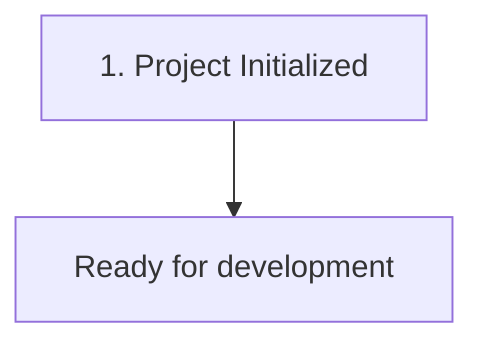

# {{PROJECT_NAME}} — Master Architectural Context, Problem Log & Operations Manual

> **Last Updated:** {{DATE_NOW}}  
> **Project Directory:** `{{PROJECT_DIR}}`  
> **Repository Name:** `{{PROJECT_NAME}}`  
> **Primary Stack:** {{STACK}} ({{FRAMEWORK}})  

---

## 1. Master Credentials & Configuration Vault

> 🔒 **Local Sandbox Isolation:** Mock test logins, seed users, and local dev ports are stored in [`context.local.md`](file://{{PROJECT_DIR}}/context.local.md) (strictly protected by `.gitignore` and `chmod 600`). Real secrets reside exclusively in `.env`.

| Property | Value / Setting | Description |
| :--- | :--- | :--- |
| **Project Name** | `{{PROJECT_NAME}}` | Active project identifier |
| **Environment** | Development / Production | Current runtime environment |
| **Base Port** | TBD | Application listening port |
| **API Endpoints** | TBD | Service URL / Domains |
| **Secrets / Keys** | Secured in Vault | Credentials, API tokens, passwords |
| **Test Fixtures** | `context.local.md` | Local dummy test credentials (git-ignored) |

---

## 2. Chronological Problem Log & Technical Solutions



| # | Symptom / Error Message | Root Cause | Exact CLI Solution & Code Patch |
| :-: | :--- | :--- | :--- |
| 1 | Initial setup | Clean repository initialization | Generated autonomous context framework |

---

## 3. System Architecture & Tech Stack

* **Primary Stack:** {{STACK}}
* **Framework:** {{FRAMEWORK}}
* **Database / Cache:** TBD
* **Deployment Target:** TBD

```
{{PROJECT_NAME}}/
├── .agents/
│   ├── rules/
│   │   ├── code-standards.md
│   │   ├── maintain_context.md
│   │   └── security-boundaries.md
│   └── skills/
│       ├── browser-testing/
│       ├── docker-ops/
│       ├── git-workflow/
│       └── server-diagnostics/
├── AGENTS.md
├── GEMINI.md
├── context.local.md
└── context.md
```

---

## 4. Setup, Reproduction & Operations Runbook

### Prerequisites
* Operating System: Linux / WSL2 / Windows / macOS
* Runtime / Package Manager: TBD

### Quick Start
```bash
# Setup instructions will be populated automatically by AI assistant
```

---

## 5. Skills & Progressive Disclosure Catalog

> 💡 **Progressive Disclosure Protocol:** Agents must NOT read full `SKILL.md` files upfront. When user prompts match any triggers, dynamically inspect the skill file using `read_file`.

| Skill | Version | Purpose & Scope | Triggers | Location |
| :--- | :---: | :--- | :--- | :--- |
| **`docker-ops`** | 1.0.0 | Production Dockerfile & Compose orchestration | `docker`, `container`, `compose` | [SKILL.md](file://{{PROJECT_DIR}}/.agents/skills/docker-ops/SKILL.md) |
| **`git-workflow`** | 1.0.0 | Conventional commits & merge conflict resolution | `git`, `commit`, `branch`, `rebase` | [SKILL.md](file://{{PROJECT_DIR}}/.agents/skills/git-workflow/SKILL.md) |
| **`server-diagnostics`** | 1.0.0 | System health, RAM/swap, CPU, ports & sockets | `health`, `ram`, `cpu`, `swap`, `port` | [SKILL.md](file://{{PROJECT_DIR}}/.agents/skills/server-diagnostics/SKILL.md) |
| **`browser-testing`** | 1.0.0 | UI testing & mock logins using `context.local.md` | `browser`, `playwright`, `puppeteer`, `ui-test` | [SKILL.md](file://{{PROJECT_DIR}}/.agents/skills/browser-testing/SKILL.md) |

---

## 6. Autonomous Documentation Policy
* Maintained automatically by AI assistants (Antigravity, Cursor, Claude Code, Copilot, Cline, Windsurf) on every code or configuration change.
* Governed by [`GEMINI.md`](file://{{PROJECT_DIR}}/GEMINI.md) and [`.agents/rules/maintain_context.md`](file://{{PROJECT_DIR}}/.agents/rules/maintain_context.md).

