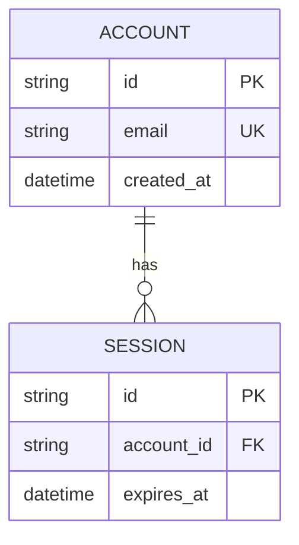

# Architecture: Database Schema & Data Models

## Overview
Database schema definitions, storage layout, entity relationships, and migrations for {{PROJECT_NAME}}.

## Entity Relationship Overview

## Migration & Data Invariants
1. **Idempotency:** Schema migrations must execute deterministically without data duplication or side-effects.
2. **Zero Plaintext Secrets:** Passwords, private keys, and tokens must be securely hashed and never stored in raw text.
