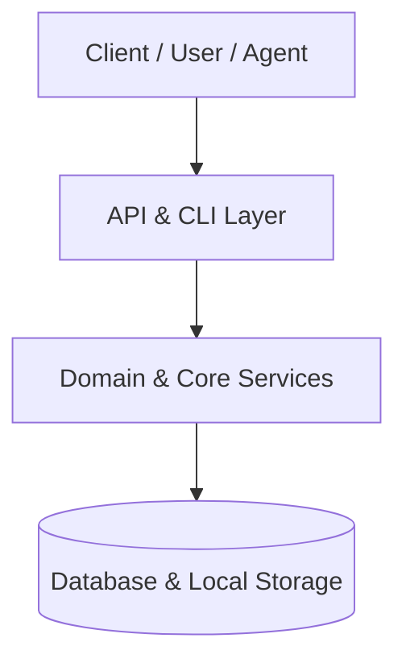

# Architecture: System Design

## Overview
High-level system architecture and structural boundaries for {{PROJECT_NAME}}.

- **Primary Runtime / Stack:** {{STACK}}
- **Framework / Core Engine:** {{FRAMEWORK}}
- **Working Root:** `{{PROJECT_DIR}}`

## Component Architecture
- **Presentation / Ingestion Layer:** User interfaces, CLI command parsers, API controllers.
- **Domain & Application Services:** Business logic, orchestrators, core pipelines.
- **Data & Persistence Layer:** Database entities, migrations, and local storage caches.

## Architectural Guidelines
1. **Separation of Concerns:** Keep core domain logic strictly decoupled from transport or command parsers.
2. **Defensive Boundaries:** Validate all incoming parameters and handle edge cases gracefully with early returns.

