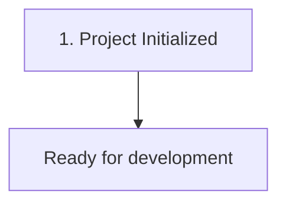

# {{PROJECT_NAME}} — Master Architectural Context, Problem Log & Operations Manual

> **Last Updated:** {{DATE_NOW}}  
> **Project Directory:** `{{PROJECT_DIR}}`  
> **Repository Name:** `{{PROJECT_NAME}}`  
> **Primary Stack:** {{STACK}} ({{FRAMEWORK}})  

---

## 1. Master Credentials & Configuration Vault

| Property | Value / Setting | Description |
| :--- | :--- | :--- |
| **Project Name** | `{{PROJECT_NAME}}` | Active project identifier |
| **Environment** | Development / Production | Current runtime environment |
| **Base Port** | TBD | Application listening port |
| **API Endpoints** | TBD | Service URL / Domains |
| **Secrets / Keys** | Secured in Vault | Credentials, API tokens, passwords |

---

## 2. Chronological Problem Log & Technical Solutions



| # | Symptom / Error Message | Root Cause | Exact CLI Solution & Code Patch |
| :-: | :--- | :--- | :--- |
| 1 | Initial setup | Clean repository initialization | Generated autonomous context framework |

---

## 3. System Architecture & Tech Stack

* **Primary Stack:** {{STACK}}
* **Framework:** {{FRAMEWORK}}
* **Database / Cache:** TBD
* **Deployment Target:** TBD

```
{{PROJECT_NAME}}/
├── .agents/
│   └── rules/maintain_context.md
├── AGENTS.md
├── GEMINI.md
└── context.md
```

---

## 4. Setup, Reproduction & Operations Runbook

### Prerequisites
* Operating System: Linux / WSL2 / Windows / macOS
* Runtime / Package Manager: TBD

### Quick Start
```bash
# Setup instructions will be populated automatically by AI assistant
```

---

## 5. Autonomous Documentation Policy
* Maintained automatically by AI assistants (Antigravity, Cursor, Claude Code, Copilot, Cline, Windsurf) on every code or configuration change.
* Governed by [`GEMINI.md`](file://{{PROJECT_DIR}}/GEMINI.md) and [`.agents/rules/maintain_context.md`](file://{{PROJECT_DIR}}/.agents/rules/maintain_context.md).
